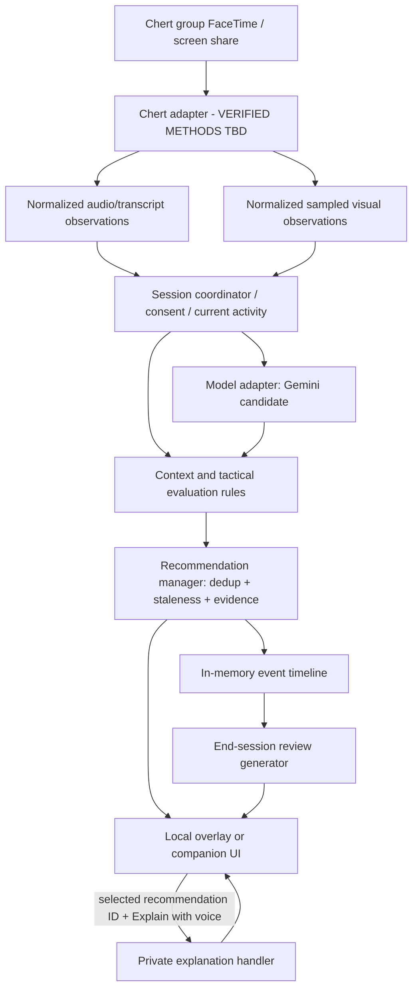

# Sidekick AI — Engineering Specification

**Status:** Architecture and **internal** contracts proposed for MVP; external Chert interfaces **not yet verified**.  
**Primary scope:** One gaming session using real Chert group FaceTime + screen share, proactive quiet text overlay, selected recommendation privately spoken on the requester’s device, event-based debrief.  
**Authority:** Product scope → `requirements.md`; tech commitments → `techstack.md`; build order → `phases.md`; UI → `design.md`.

> **Engineering rule:** Don't build an imaginary Chert SDK. First inspect the sponsor starter and live event payloads. Everything below that references an external integration is a **boundary to implement**, not an assertion that Chert exposes a particular API or endpoint.

## 1. System architecture



### Separation of concerns

- **Chert adapter:** handles external call events/audio/video; normalizes provider details; reports actual capability flags.
- **Session coordinator:** consent, participants, activity, goals, role assignments, lifecycle, latest observations, event history.
- **Model adapter:** extracts structured observations from available frames and conversation; optional explanation/review generation. It never unilaterally declares observed facts true.
- **Situation evaluator:** combines structured current observations, agreed roles/goals and simple tactical rules.
- **Recommendation manager:** prioritizes, deduplicates, timestamps and tracks the lifecycle of advice.
- **Overlay:** presents text cards and buttons; no provider credentials.
- **Voice handler:** selects an existing recommendation, checks staleness, prepares grounded detail and returns explanation text for **private local speech playback** on the requester’s device, never publishing audio to Chert/FaceTime.
- **Review service:** summarizes logged evidence, separates facts/participant reports/inferences, records unknowns.

## 2. Proposed repository layout — scaffold only after starter inspection

```text
sidekick-ai/
  README.md
  CLAUDE.md
  docs/{requirements,techstack,engineering,phases,design}.md
  src/
    adapters/
      chert/              # actual Chert API wrapper, names TBD
      model/              # Gemini or other verified runtime provider
    sessions/             # session state, consent, lifecycle, memory
    observations/         # sampled vision, transcript normalization
    reasoning/            # activity identification, tactical rules
    recommendations/      # create, dedup, stale, explain requests
    reviews/              # log + summary
    api/                  # only endpoints needed by UI/voice flow
  overlay/                # minimal web/desktop UI, exact shape TBD
  tests/                  # pure logic / contract / smoke tests
  .env.example            # verified names only
```

**Implemented so far (session engine, mock inputs only):** `src/contracts/` (shared types + validation), `src/sessions/timeline.ts`, `src/recommendations/recommendation-rules.ts`, `src/engine.ts`, `src/mock/` (clearly labeled mock scenario) and `tests/`. Other folders do not exist yet.

Keep actual Chert starter source layout when it already solves these needs; this tree is a **recommended logical layout**, not a mandate to rewrite starter code.

## 3. Internal data contracts (approved 2026-11-14, revised after review; implemented in `src/contracts/types.ts`)

These interfaces are **ours**, not Chert's event schema. The single source is [`src/contracts/types.ts`](../src/contracts/types.ts); this section summarizes it. If they disagree, fix one of them in the same change. Input validation lives in [`src/contracts/validate.ts`](../src/contracts/validate.ts).

**Status:** implemented and unit-tested with **mock inputs only**. Not yet connected to Chert, Gemini or any UI.

| Contract | Key fields | Notes |
|---|---|---|
| `SessionSnapshot` | `id`, `externalRef?`, `status`, `consentGiven`, `activity`, `activityConfirmed`, `suggestedActivity?`, `contextRevision`, **`captureGeneration`**, `participants[]`, `goals[]`, `decisions[]`, `recommendations[]`, `voiceRequests[]`, `observationCount`, `observationLimitReached`, `timelineTruncated` | Session IDs are engine-generated. `externalRef` is an opaque adapter handle, never parsed. Producers read `captureGeneration` and `contextRevision` from here (§3.2). |
| `Participant` / `RoleChange` | `id`, `displayName`, `externalRef?`, `role?` (string), `lastRoleChange?: { revision, kind: assigned\|cleared, role?, previousRole?, effectiveAt, recordedAt, source, sourceObservationId? }` | `role` is the single source of truth. `lastRoleChange` is kept even after a clear, so the engine can order later changes. |
| `GroupGoal` | `id`, `text`, `statedAt`, `recordedAt`, `source`, `sourceObservationId?`, `revision`, `active`, `retiredAt?`, `retiredRevision?`, `retiredSource?`, `retiredSourceObservationId?` | Explicitly stated goals only. |
| `GroupDecision` | `id`, `text`, `decidedAt`, `recordedAt`, `source`, `sourceObservationIds[]`, `participantIds[]`, `relatedRecommendationId?`, `relatedGoalId?` | Recorded only through `recordDecision` and never inferred. A transcript-sourced decision must cite conversation observations. |
| `ConversationObservation` | `source: 'transcript'`, `text`, `speakerParticipantId?`, `observedAt`, `receivedAt` | The speaker is set only when `speakerRef` matches a participant's verified `externalRef`. |
| `ScreenObservation` | `source: 'screen'`, `summary`, `evidenceQuality`, `facts?`, `frameRef?`, `observedAt`, `receivedAt` | Structured description only. `frameRef` is a short reference (no `data:` URIs) and never reaches the overlay. |
| `ConversationInput` / `ScreenInput` | **`captureGeneration`** (required) + the observation fields minus `id`/`sessionId`/`receivedAt` | **What producers send.** The Chert adapter sends `ConversationInput`; the model adapter sends `ScreenInput`. Observations keep their `captureGeneration`. |
| `ContextOptions` | `source: transcript\|participant_report\|manual`, `sourceObservationId?` | `transcript` **requires** a `sourceObservationId` pointing to a conversation observation. |
| `RecommendationCandidate` | `fingerprint`, `title` (≤80), `shortAdvice` (≤200), **`conditionObservationIds`** (≥1), **`contextObservationIds?`**, `relatedParticipantIds?`, `relatedGoalId?`, `urgency`, **`basedOnContextRevision`** (required) | Condition evidence shows the issue itself (e.g. the empty-zone frames). Context evidence (e.g. the role utterance) never affects freshness. `basedOnContextRevision` is the `contextRevision` the reasoning layer evaluated against. |
| `Recommendation` | candidate fields + `id`, `status`, `staleReason?`, `createdAt`, `updatedAt`, `statusChangedAt`, `lastConditionAt`, `resolvedByObservationId?`, `contextAtCreation` | `lastConditionAt` only moves forward. `contextAtCreation` freezes the related roles and goal as they were when the card was created. |
| `VoiceRequest` | `id`, `recommendationId`, `requesterParticipantId?`, `status: pending\|playing_locally\|finished\|failed\|cancelled`, `cancelReason?`, `requestedAt`, `updatedAt` | One ID per attempt. Every callback must quote it. |
| `ExplanationContext` | `recommendation`, `conditionEvidence[]`, `contextEvidence[]`, `contextAtCreation`, `changesSinceCreation[]`, `isStale`, `staleReason?`, `conditionAgeMs` | Grounding for one card. Later corrections are listed separately, never merged into the original context. |
| `SessionEvent` | `id`, `sessionId`, `time`, `recordedAt`, `summary` + a **typed payload per `type`** | See the event list below. `summary` is a display label only; the review reconstructs everything from the structured fields. |
| `OverlayState` / `RecommendationView` | **`version`** (monotonic), `status`, `activity`, `prominent?`, `history[]` (newest first), `voiceBusy`, `activeVoiceRequest?`; each card has `evidence[]` (`kind: condition\|context`), creation-time `relatedParticipants[]`, `contextChangedSinceCreation`, `staleReason?`, `canExplain`, `voice?` | Plain JSON. Contains no fingerprints, adapter refs, frame refs or transcript text. |
| `Result<T>` | `{ ok: true, value }` or `{ ok: false, error, detail? }` | Public methods never throw on malformed input. A fuzz test covers every method. |

**Event payloads.** `role_updated` carries the full `RoleChange`. `goal_set` and `goal_retired` carry `goalId`, `source`, `sourceObservationId?` and `revision`. `decision_recorded` carries the `GroupDecision`. `observation` carries `observationId`, `source` and `speakerParticipantId?`. `recommendation_created` carries the condition/context IDs, related participants, goal and `contextRevision`. `recommendation_stale` carries a `reason` (`no_recent_condition_evidence`, `session_paused`, `session_ended`, `role_changed` or `goal_changed`) plus `participantId?`/`goalId?`. `voice_requested` and `voice_finished` carry `voiceRequestId`, `outcome` and `cancelReason?`. The remaining payloads are the lifecycle events, `participant_added`, `activity_confirmed`, `recommendation_dismissed` and `recommendation_resolved` (with its `observationId`). `time` is the source time for observations and transcript-derived context, and engine time otherwise; `recordedAt` is always engine time.

**Data invariants:** A recommendation belongs to one session and cites one or more condition observations from that same session. The explanation button sends a **recommendation ID** and receives a **voice request ID**, never an arbitrary instruction. A session review only cites `SessionEvent`/`Observation` objects belonging to that session. Speaker IDs remain optional until real diarization is verified.

### 3.1 Session engine (`SidekickEngine`, `src/engine.ts`)

In-memory `Map` keyed by session ID. It has no I/O, no timers, no persistence and no provider code. The clock and ID generator are injectable for tests. **Out of scope by design:** Chert I/O, Gemini reasoning, game-state interpretation and tactical rules, role/goal/decision extraction from speech, explanation text generation, and private local speech playback.

| Area | Methods |
|---|---|
| Lifecycle | `createSession`, `startWithConsent`, `pause`, `resume`, `end`, `discard` |
| Context | `addParticipant`, `assignRole`, `clearRole`, `setGoal`, `retireGoal`, `recordDecision`, `suggestActivity`, `confirmActivity` |
| Ingest | `ingestConversation`, `ingestScreen`, `getObservation`, `getLatestObservation` |
| Recommendations | `proposeRecommendation`, `dismiss`, `resolve`, `sweepStale`, `sweepAll` |
| Voice | `getExplanationContext` (read-only), `requestExplanation`, `reportVoiceStatus`, `cancelExplanation` |
| Reads / UI | `getSession`, `getOverlayState`, `getTimeline`, `subscribe` |

**Capture generations.** Timestamps can't reliably say whether something was captured before or after a pause, because producer clocks may be skewed. Instead, the engine keeps `captureGeneration`, an integer that starts at 0 and increments on every start, pause, resume and end (start = 1, pause = 2, resume = 3, …). Generations during which the session was active are recorded. The producer stamps each input with the generation it read **when the raw input was captured**, and every input must carry one. Ingest rejects with `invalid_generation` any input:
- stamped with a paused or ended generation, i.e. captured while not observing;
- stamped with an unknown or future generation;
- whose generation is malformed.

Inputs from an **earlier active** generation are stored and placed in the timeline, so they can serve as context evidence or role/goal provenance. They can **never** be condition evidence: `stale_evidence` "captured before the last pause/resume". This replaces the earlier rule that relied only on timestamps around a pause. A post-resume capture whose clock lags into the pause window is therefore valid, and a pre-pause capture whose clock runs ahead is not.

**Timestamp rules.** `observedAt` must be ISO 8601 with a timezone. Calendar overflow such as Feb 30 is rejected; the engine normalizes accepted values to UTC. The engine rejects an observation (`timestamp_out_of_range`) when it is:
- more than `maxClockSkewMs` in the future;
- earlier than consent minus the skew.

Late observations inside those bounds are stored and placed in the timeline at their source time. They don't replace the latest observation of their source unless they are newer by source time. As condition evidence, a late observation can extend a card's freshness only if its `observedAt` is newer than the card's `lastConditionAt`.

**Role ordering and precedence.** Each role change has an `effectiveAt`: the utterance's `observedAt` for `transcript` changes, and engine time for `manual` or `participant_report` changes. A clear counts as a change. The rules:
- A **verified correction** (`manual` or `participant_report`) always applies over whatever is currently applied. Corrections are live user actions, ordered by arrival. Any applied transcript change was admitted with `observedAt ≤ arrival + maxClockSkewMs`, so it can't be later than the click.
- A **transcript-derived change** applies over a verified correction only if `effectiveAt > correction + maxClockSkewMs`, meaning it was certainly spoken afterwards even at the maximum allowed skew. With `maxClockSkewMs: 0`, the statement has to be strictly after the correction.
- **Transcript vs transcript:** the newer or equal utterance time wins.

Restating the current role refreshes the ordering without creating an event. Ignored changes return `outcome: 'ignored_superseded'` and do not bump `contextRevision`.

**Context revision (reasoning contract).** `contextRevision` increments on every applied role assignment, role clear, goal set and goal retirement. Restatements and ignored changes don't increment it. The reasoning layer reads it before evaluating a rule and returns it as `basedOnContextRevision`. If any role or goal changed in between, the candidate is rejected with `stale_context` and must be re-evaluated. A changed role belonging to an unrelated participant also counts, because "who covers left" can change through anyone. So a delayed result can never recreate or refresh advice that a newer correction invalidated. A revision newer than the session's is `invalid_input`. Accepted cards record the revision in `contextAtCreation.contextRevision`.

**Recommendation rules** (`src/recommendations/recommendation-rules.ts` + `proposeRecommendation`):

1. Only `conditionObservationIds` affect freshness. A screen observation with `evidenceQuality: 'unknown'` can't be condition evidence (`insufficient_evidence`).
2. A candidate is rejected:
   - with `stale_context` if `basedOnContextRevision` is behind the session;
   - with `stale_evidence` if any condition observation is from an earlier capture generation;
   - with `stale_evidence` if its newest condition evidence is older than `staleAfterMs`.

   After a pause, only condition evidence captured after the resume can create a card.
3. If a card with the same `fingerprint` is **active**, the candidate is **merged**. Evidence is appended, `lastConditionAt` advances only on newer condition evidence, and the card's text and creation context stay unchanged. No new card and no event.
4. If the most recent same-fingerprint card was **dismissed or resolved** less than `cooldownMs` ago, the candidate is **suppressed**.
5. A **stale** card doesn't block a new card for the same issue, as long as the new card's own evidence passes rule 2.
6. A card becomes stale when:
   - `now − lastConditionAt > staleAfterMs` (checked on every ingest, propose, `sweepStale` and `sweepAll`);
   - the session pauses or ends;
   - a related participant's role changes (`role_changed`) or the related goal is retired (`goal_changed`).
7. `resolve` requires fresh, already-eligible, clear screen evidence from the current capture generation, strictly newer than `lastConditionAt`. The production coordinator enables the controlled-soccer rule for `left_defense_uncovered`: only active cards resolve, and only when the newest eligible screen shows `leftZoneVisible === true` and `leftZoneUncovered === false`. Every screen tied at that newest timestamp must agree; missing facts or uncertain quality prevent resolution. Stale cards are left unchanged. This runs before asynchronous reasoning, including when future-stamped observations become eligible. The engine records the resolving observation ID and rejects subsequent same-fingerprint proposals whose newest condition evidence is at or before a resolution in the current generation, even after cooldown expires.

**Voice requests.** `requestExplanation` creates a request with a unique ID; only one request per session can be live at a time (`voice_busy`). `reportVoiceStatus` accepts `playing_locally`, then `finished` or `failed`, and only for the current live request. Unknown IDs return `voice_request_not_found`; superseded or terminal IDs return `invalid_transition`. Playback can't start unless the session is active. Cancellation rules:
- **Pause:** `cancelled` with reason `session_paused`.
- **End:** `cancelled` with reason `session_ended`.
- **Recommendation resolved:** a live explanation of that card is `cancelled` with reason `recommendation_resolved`, in the same engine operation as resolution; the overlay stops its local speech when the active request disappears.
- **Stop button or disconnected client:** `cancelExplanation` with reason `user` or `client_disconnected`.
- **No callback within `voiceRequestTimeoutMs`:** `cancelled` with reason `timeout`.
- **Discard:** the request is abandoned with the session; later callbacks return `session_not_found`, and the discarding UI must stop its own playback.

The UI must stop speaking whenever `OverlayState.activeVoiceRequest` disappears or changes. Speech synthesis is **not** in the engine; playback is local to the requester's device and never enters the shared call.

**Overlay notification semantics.** Listener callbacks never run inside an engine operation. Each change bumps the session's `version`, and when the outermost public call returns, the engine delivers the **current** `OverlayState` to each listener that is behind, in subscription order. Calls a listener makes during delivery (reentrant calls) run as normal, complete operations. They don't deliver anything themselves. If one of them changes the state, the current delivery round stops and restarts with the newer state. The guarantees:
- every listener receives strictly increasing `version`s and ends on the latest state;
- a listener never receives a snapshot from before a pause, end or cancellation that has already happened;
- after `discard`, nothing more is delivered.

A listener that keeps changing state on every callback is stopped after 50 rounds per flush and reported through `onListenerError`. If a transport can reorder messages, the UI should ignore any snapshot whose `version` is not greater than the last one it applied.

**Configuration** (`EngineConfig`, all overridable in the constructor): `cooldownMs` 30 000, `staleAfterMs` 15 000, `maxClockSkewMs` 5 000, `maxObservations` 2 000, `maxTimelineEvents` 5 000, `voiceRequestTimeoutMs` 60 000. These are **test/demo defaults**, not tuned values.

**Bounds.** Observations are capped per session; past the cap, new ones are rejected with `observation_limit_reached` and `observationLimitReached` is set. Timeline events are capped too; past the cap, new events are dropped (except `session_ended`) and `timelineTruncated` is set so the review can state the gap. Participants, goals, decisions and voice requests are not separately capped; they grow only through explicit calls.

**Privacy.** Everything is held in memory. The engine accepts no raw audio, video or frames; screen input is a text summary plus primitive facts. Transcript text stays on its observation, and timeline summaries say only who spoke. `discard()` clears observations, recommendations, participants, role history, goals, decisions, voice requests, the timeline and every overlay subscription, then deletes the session.

### 3.2 Integration seams

- **Chert adapter → engine:** call `createSession({ externalRef })` once per call and keep the returned session ID. Call `startWithConsent` only after explicit opt-in. For each transcript event, map it to `ConversationInput` and call `ingestConversation`. Set `speakerRef` (and the participants' `externalRef`) only if CH-3 proves speaker attribution. Frames go to the **model adapter**, which calls `ingestScreen` with a `ScreenInput`. **Capture generation:** when a Chert transcript event or frame arrives, the adapter reads `getSession(id).captureGeneration` (or keeps the value returned by `startWithConsent`/`resume`) and attaches it to that raw input, before any queueing or model call. The same number must travel with the frame into the model adapter and on to `ingestScreen`; it must never be re-read at ingest time. This needs no Chert field, and nothing is assumed about Chert timestamps. If the adapter can't tell when a buffered input was captured, it should drop that input after a pause rather than guess. Call `sweepAll()` every 1–2 s. If the requesting client disconnects, call `cancelExplanation(…, 'client_disconnected')`. The engine never sees Chert types.
- **Reasoning layer → engine:** reads `getSession` / `getLatestObservation`. Calls `assignRole`/`clearRole`, `setGoal`/`retireGoal`, `recordDecision` and `confirmActivity` with `source: 'transcript'` and the source utterance ID. Calls `proposeRecommendation`, separating condition evidence from context, and `resolve` when a newer frame shows the issue fixed. Re-proposes after a `role_changed` or `goal_changed` invalidation if the advice still applies. **Every candidate carries `basedOnContextRevision`:** the reasoning module (Gemini adapter) reads `getSession(id).contextRevision` together with the roles and goals it puts in the prompt, and sends that number back with the result. On `stale_context`, it re-reads the context and re-evaluates; it must not retry the same candidate.
- **Engine → overlay:** `subscribe(sessionId, listener)` emits a full `OverlayState` when the subscribe call returns, and after each operation that changes state. Snapshots carry a monotonic `version`. The transport is the integrator's choice. The UI sends back `dismiss` and manual role corrections (`source: 'manual'`). For Explain, it calls `requestExplanation` → backend generates text from `context` → the requester's device plays it locally → `reportVoiceStatus(requestId, …)`, or `cancelExplanation` on Stop.
- **Engine → review:** `getTimeline` returns ordered, typed events. `getObservation` resolves evidence, and `getSession` provides goals, decisions and role history.

## 4. Session lifecycle and privacy

| State | Input processing | Text/voice behavior | Review behavior |
|---|---|---|---|
| `starting` | No continuous capture until consent | Show setup/permissions | None |
| `active` | Process approved audio+screen input; sampled vision | Proactive quiet **text**, voice only on selected button | Record minimal events |
| `paused` | Stop **new** observation processing | Mark existing cards stale if needed; do not generate new advice | Retain prior event log in memory |
| `ended` | Stop input and do not rejoin automatically | No further live advice | Offer Generate Review / Discard |

All participants should be informed of live AI processing and be able to see active state. Consent must be explicit, not inferred because someone joined the call. Never run persistent background capture; stop new inference on Stop/Pause. Raw audio and video are not retained by default. Review event history is in memory and can be discarded; do not upload it to public telemetry.

## 5. Conversation and visual observation loop

1. Chert receives a call event. Convert actual supported payloads into our normalized `Observation` objects.
2. Track stated roles and goals using explicit wording and corrections; don't guess who spoke if no speaker ID exists.
3. On approved screen share, sample a frame as budget/latency permits. **3–5 seconds is an experimental starting point, not guaranteed performance.**
4. Ask the model for a **structured description** of only what the frame shows, with evidence-quality indication. Do not infer unseen score, player identity or invisible game state.
5. Apply narrow tactical logic for the chosen demo: *assigned left defender absent from clearly defined left defensive zone and no visible coverage → left zone may be exposed*. If detection confidence is insufficient, withhold or hedge the suggestion.
6. Compare to prior state; generate one relevant text card, deduplicate repeated observations, and log the evidence.
7. Continue quietly. **No automatic speech** for recommendations.

A deterministic soccer-field simulation with visible labeled/colored markers can make the visual condition testable; commercial game understanding is a stretch.

## 6. Recommendation lifecycle

```text
new grounded issue → candidate → dedup / relevance check → ACTIVE CARD
                                            |
                        new observation? → update / mark resolved / stale
                        user dismisses → dismissed
                        user taps Explain with voice → voice flow
```

The concrete, implemented rules are listed in §3.1. MVP safeguards:

- Only one prominent recommendation displayed at a time; history can retain earlier cards.
- Key the underlying issue with a stable fingerprint (e.g., `left_defense_uncovered` + session/game context), so multiple frames of the same issue do not spam cards.
- Use a brief cooldown after an equivalent recommendation; exact duration is a tuning value.
- Do not mark issue resolved without a newer observation supporting it.
- A card is **stale** if there is no recent supporting observation; don't read old advice as a current fact.
- Model outputs are untrusted suggestions: validate structure, size, evidence links and phrasing before UI display.

## 7. Selected recommendation → private speech flow

1. User clicks the **Explain with voice** control attached to `recommendationId`.
2. Backend verifies active session and the card's ownership/status; fetches stored short advice, referenced observations, group goals and roles.
3. If evidence is outdated, preface explanation with “Earlier…” or say it's no longer confirmed.
4. Generate concise expanded guidance: **what was observed → why it matters → suggested corrective actions → any uncertainty**.
5. Return the grounded explanation to the requesting user’s companion UI. Trigger **local speech synthesis**, ideally from the user’s click, without publishing any audio track to Chert, LiveKit, or FaceTime.
6. Track each attempt as a voice request with a unique ID: `pending` → `playing_locally` → `finished`, `failed` or `cancelled` (see §3.1). Return to quiet text automatically. No overlapping explanations, and stale callbacks are rejected.
7. If private playback fails, display the detailed text explanation **clearly labeled as a fallback**. Test cancel/stop and check microphone loopback; recommend headphones.

**Example expected words, if evidence supports them:** “Earlier, your assigned left defender advanced and the left defensive area looked open. If possession changes, that space could be exploited. Have Alex recover or ask another teammate to cover the left.”

## 8. End-of-session event review

At `ended`, the UI offers **Generate Review** or **Discard**. The review generator accepts the bounded event timeline (`maxTimelineEvents`; truncation is flagged) and related structured observations; it does not need or automatically retain a raw recording.

Proposed review contract:

```ts
interface SessionReview {
  sessionId: string;
  generatedAt: string;
  activity: string;
  overview: string;
  keyMoments: Array<{ eventIds: string[]; time?: string; whatHappened: string }>;
  strengths: string[];                 // omit if no supporting evidence
  improvementAreas: string[];          // cite observed events in UI when possible
  nextActions: string[];
  limitations: string[];               // gaps, uncertain identities, sparse sampling
}
```

The review is about **observed moments**, not complete match telemetry. `voice_requested` indicates interest in the advice, not proof the player followed it. Generate “not enough evidence” when appropriate. Keep event count bounded and allow explicit discard.

## 9. Internal interfaces (examples, not implemented endpoints)

Prefer the Chert starter's transport. If a companion overlay needs an API, it might need these **internal operations**, regardless of REST/WebSocket shape:

| Operation | Inputs | Returns / effect |
|---|---|---|
| `getSessionState` | authenticated/paird session reference | consent/status/activity/current cards |
| `getRecommendations` | session reference | latest short cards with stable IDs |
| `requestVoiceExplanation` | authorized requester, session reference, `recommendationId` | grounded explanation text and playback status for local TTS; no shared audio |
| `endSession` | session reference | observation processing stopped; review offered |
| `generateReview` | ended session reference | event-grounded summary |
| `discardSession` | session reference | clear in-memory event/context data |

Do not expose these publicly without session scoping, restricted origin, appropriate short-lived access/pairing, input validation and limits. **Do not interpret these operation names as existing Chert endpoints.**

## 10. Integration verification gates — REQUIRED before locking adapter design

| Test | Procedure | Pass evidence / fallback |
|---|---|---|
| **CH-1 Group FaceTime** | Agent joins a real group call | Actual call + stable session ID; else stop and fix setup |
| **CH-2 Incoming screen share** | Participant shares recognizable game/simulation screen | Agent process receives verifiable frame from screen stream; if unavailable, document actual API and reconsider capture path |
| **CH-3 Conversation processing** | State role then query session context | Observed transcript/raw input available; if no speaker attribution, require explicit names |
| **CH-4 Private voice** | Click a selected card on a participant’s device | Explanation plays only on that device. Verify no audio track goes to Chert and, using headphones, that other FaceTime participants do not hear it |
| **CH-5 Overlay feasibility** | Display suggestion over game on target desktop | If true overlay fails, companion panel is clearly labeled a fallback and overlay P0 remains incomplete |
| **CH-6 Session end** | Stop then request review | No new frames/audio processed; report uses logged events |

Keep short notes on **tested date, setup, actual SDK interface, successful result, latency, errors, limitations, and owner**. Never check in raw private event payloads if they contain sensitive identifiers or content; redact examples.

### Explicit current unknowns

- Chert method/event for **incoming FaceTime screen-share frames** (team says capability exists, API unknown).
- Incoming **audio vs transcripts**, participant attribution and timing.
- Supported **private local speech synthesis** and cancellation; user-gesture requirements; avoid call audio injection and test acoustic feedback.
- Supported **overlay rendering**: OS-native over-game, companion browser panel, or FaceTime outgoing video are not interchangeable.
- Callback/network/hosting requirements; sampling throughput, latency/cost; simultaneous video/speech routing.

## 11. Testing requirements

Session-engine unit tests live in `tests/` and run with `npm test` (they cover lifecycle, consent, roles, observations, recommendations, timeline, overlay snapshots, voice grounding and a mock smoke scenario). Contract tests for model output and the voice endpoint, and all live tests below, are still open.


- Unit: new role updates supersede old role; session isolation; activity confirmation; fingerprint dedup; cooldown; stale/resolved rules; no unsourced confidence or invented metrics; stopped session ignores observations.
- Contract: malformed model output rejected; invalid recommendation ID cannot trigger speech; cross-session IDs cannot read other sessions; repeated explain button cannot cause overlapping speech.
- Review: references valid event IDs; explicitly unknown outcomes remain unknown; no events → honest empty review.
- Manual end-to-end: real call + screen visual change + quiet card + selected **private local speech** + debrief, rehearsed twice on target network.
- Failure: Chert disconnect; no screen; delayed frame; unavailable transcript; model timeout; voice failure; overlay hidden; participant stops monitoring.

## 12. Priority and change procedure

The **product** is locked in `requirements.md`. Internal schemas here are the **proposed default** and may be revised when the working Chert starter proves a different data model is necessary. Change this document **before** simultaneously updating multiple modules, note the reason, update tests and any `phases.md` dependency. Keep integration adapters thin; never pretend the software already exists because this spec names a module.

## Decision update — private explanation (confirmed 2026-11-14)

- **Who hears it:** Only the participant who clicked **Explain with voice** on a selected recommendation.
- **Where it plays:** Locally on that participant’s companion device, preferably through headphones. No TTS audio may be published into the FaceTime/LiveKit room or shared Chert call. If speakers are used, acoustic microphone pickup can still leak audio; test and warn.
- **How it works:** The backend returns grounded explanation **text** tied to the selected recommendation ID and event evidence; the local UI handles TTS playback, stop/cancel, and an on-screen text fallback. Browser `speechSynthesis` is a candidate, not a finalized tested dependency.
- **Unchanged:** Continuous group-aware input during an explicitly consented active session; proactive quiet overlay advice; gaming-first hackathon MVP; mandatory event-based end-of-session review.
- **Dami/PITWALL reconciliation:** Adopt the private companion audio concept and modular Chert + Gemini + session-coordinator architecture, but **do not** expand MVP scope to iMessage, an always-on general assistant, a browser extension, or five separate modes.

## Gemini reasoning boundary (feature/gemini-reasoning)

The independently runnable reasoning module uses normalized ENGINE-INGESTED observations with IDs,
session IDs, capture generations and source timestamps. It accepts a read-only session snapshot,
engine clock and explicit staleAfterMs. It returns proposed context updates and recommendation
candidates with separate condition/context evidence, preserving contextRevision. No state mutation,
deduplication, lifecycle, Chert or frontend behavior is owned by reasoning. Exact quotes and local
freshness/scope checks supplement model prompting, but do not prove semantic entailment.

The published session-engine contract at 1bc0e9f1414fdb18dbcb95f4f41b79d80a0e9a88 is the integration
reference. Structural type compatibility and real-engine acceptance are checked in a temporary copy;
shared contracts are not overwritten. Apply context updates through engine APIs, re-read state,
and re-evaluate if revision changes. Cancel on Pause/End and let the engine reject stale late results.
See docs/reasoning.md for complete handoff, limitations and commands. Raw-frame ingestion and live
Chert remain unverified; the Gemini adapter reasons over supplied summaries, not fetched frameRef media.

## Imported LiveKit Agent Builder export (2026-11-14)

The Agent Builder export is integrated under `agent/`; the source and its entrypoint are preserved. Inspection of `agent/src/agent.py` shows a LiveKit `AgentServer` with an `rtc_session` entrypoint, an `AgentSession`, a `DuplexModel` configured as `openai/gpt-live-1`, and the exported ai-coustics audio enhancement hook. The package configuration declares `livekit-agents`, the ai-coustics and noise-cancellation plugins, `python-dotenv`, and `python-handlebars`; the dev group contains pytest, pytest-asyncio, and Ruff. The documented local entrypoint is `uv run python src/agent.py dev`; Docker starts `src/agent.py start`.

The shared runtime is pinned to Python 3.13 in `agent/.python-version`, `pyproject.toml`, CI, and Docker. The export did **not** include `uv.lock`; dependencies are still version ranges and are not yet exactly reproducible across installs. Generate and commit a lockfile when package-index access is available.

**Integration status:** these findings are from the exported source and docs only. No real LiveKit or Chert session was run. The source does not contain a Chert adapter or Sidekick recommendation/overlay/review path. Chert screen-share frame shapes, transcript events, consent/lifecycle behavior, overlay delivery, and the product's selected voice action remain unverified. Do not present the exported LiveKit starter as a tested Chert integration.

### Gemini live smoke follow-up

The normalized synthetic reasoning path was exercised against gemini-3.5-flash-lite. A provider-schema
compatibility fix omits maxItems/additionalProperties from the API schema; strict local output validation
still enforces both. A full live request returned one evidence-linked candidate successfully. Exact
quote coverage for condition and context evidence is explicitly prompted and locally verified. This
is a one-fixture Gemini transport/validation proof only; Chert, raw vision and overall accuracy remain
unverified. See docs/reasoning-verification.md for the distinction from earlier mock-only results.

## Integration milestone 1 — coordinator (implemented 2026-11-14, mock-only)

**Status:** implemented and tested **in-process with mocks only**:
- the real engine;
- the real reasoning module (`src/reasoning`) with its deterministic mock provider;
- a mock vision adapter;
- a fake clock and timers.

Milestone 1's own tests use no HTTP server, Python agent, Gemini call, Chert call or UI. The HTTP bridge (milestone 2) and Prabin's Gemini vision adapter (`docs/vision.md`) were added later.

### Components

| File | Role |
|---|---|
| `src/engine.ts` → `listObservations(sessionId, query?)` | Read-only, bounded observation query. Filters `source`, `captureGeneration`, `observedSince`, `observedUntil` and `ids` (≤100), ANDed. `limit` is 1–500 (default 100) and keeps the newest matches, or the oldest with `keep: 'oldest'`. Results are ordered by source time. No sweep, no events, no overlay version bump. |
| `src/coordinator/ports.ts` | Structural ports: `ReasoningFn` (matches Prabin's `reason()`), the **proposed** `VisionPort` (`FrameInput` → `ScreenDescription`), `CoordinatorResult` and content-free `CoordinatorDiagnostic` codes. |
| `src/coordinator/select-observations.ts` | Builds the reasoning batch (≤100) in priority order: (1) source utterances of current roles and active goals, at any age or generation; (2) every current-generation screen inside `staleAfterMs`; (3) recent transcripts (60 s window, newest 30), with the oldest dropped first. Future-stamped items are excluded individually. Limits are validated at construction (`maxBatch` ≤ `REASONING_MAX_OBSERVATIONS` = 100). It also provides `findSupersedingScreen`. |
| `src/coordinator/coordinator.ts` | `SidekickCoordinator`. It creates the engine with **its own clock**, so the engine and reasoning share one `now`. It holds only transient task state; the engine remains the single owner of session state. |
| `tests/integration/reasoning-wiring.mts` | Adapts the real `reason()` to `ReasoningFn`. The integration test loads it at runtime, and `npm run typecheck` (via `tsconfig.reasoning-compat.json`) type-checks it, so a contract drift on either side fails the type check. |

### Asynchronous rules

- **Capture generation:** `ingestFrame` snapshots the capture-time `captureGeneration` and `observedAt` **before** awaiting vision, and carries them unchanged into `ingestScreen`. The input object is never re-read after an await, and vision receives a copy. Frames from an earlier generation are not sent to vision at all (`stale_evidence`). If a pause happens while vision is running, its result is dropped (`aborted`).
- **Context revision:** each run records the snapshot's `contextRevision` and generation, then re-reads the engine after the reasoning await. The result is discarded if:
  - the session is gone;
  - the session is not active;
  - the generation moved;
  - the output's `sessionId`, revision or generation don't match what was sent;
  - roles or goals changed during the call. In this case reasoning re-runs instead of relabelling the old candidates.

  After applying context proposals, if the revision changed, that batch's candidates are dropped and reasoning re-runs, as `docs/reasoning.md` requires. An engine `stale_context` rejection also triggers a rerun. Reruns caused by context or evidence changes are capped at 3 per trigger (`maxReruns`).
- **Superseded condition evidence (added after review):** before each candidate is proposed, the coordinator looks for a current-generation screen with all of these properties:
  - not in the reasoning batch;
  - already eligible (`observedAt ≤ now`);
  - at least as new as the batch's newest screen;
  - **not equivalent** to it (`framesEquivalent`, revised after the second review). Two frames are equivalent only if both are `clear` quality and one of these holds:
    - their summaries are identical (ignoring case and whitespace) **and** their facts are identical, with "no facts" or empty facts on both counting as identical;
    - every key in the coordinator's `conditionFactKeys` option is present on **both** frames with equal values. These keys are the structured condition the rule depends on (MVP: `leftZoneVisible`, `leftZoneUncovered`), and the default is `[]`.

    Matching partial or generic facts (e.g. only `leftZoneVisible`) never make differing summaries equivalent. The coordinator never interprets summary text and never assumes model-generated facts are complete.

  If such a screen exists, the candidates are discarded (`evidence_superseded`) and reasoning re-runs on current evidence. This is conservative by design:
  - unknown or partial quality always counts as superseding, and so do differing summaries without complete condition facts;
  - transcripts never supersede condition evidence;
  - older late frames don't supersede;
  - existing recommendations, including unrelated ones, are never invalidated by this check. It only stops new candidates from a result that is out of date.

  Equivalent frames don't trigger it, so a steady stream of frames showing the same condition doesn't starve advice. **Wiring requirement:** set `conditionFactKeys` to the facts the vision adapter guarantees. Prabin's Gemini vision adapter emits canonical summaries and both MVP facts only for `clear` frames (`VISION_FACT_KEYS`, see `docs/vision.md`). Without these keys, any change in summary wording counts as superseding, and advice may never appear while frames keep arriving.
- **Idempotent context application:** checks are made against **current engine state**, re-read before **each** proposal, with no shadow copy. Duplicate proposals in the same response are therefore applied once, and distinct ones are all kept:
  - the same role from the same utterance is not re-applied;
  - a goal with the same text and source is not re-created, even if it was retired;
  - a decision with the same text and sources is not re-recorded;
  - activity is not re-suggested after the group confirms one.

  Every role and goal is applied with `source: 'transcript'` and its source utterance, so the engine's precedence rules still decide.
- **Lifecycle and reentrancy (revised after review):** each active stretch of a session (start or resume, until pause, end or discard) is a **period** with its own `AbortController` and deadline timer.
  - `pause` and `end` abort **the period that was current before the call**, then re-sync with the engine's actual status. A period created by a subscriber that resumes the session from inside the pause notification is therefore never aborted.
  - Lifecycle changes made directly on the engine are picked up through a subscription.
  - A run is revalidated before **every** engine write. The checks: same task, same non-aborted period, session still active, same generation. A subscriber that pauses, ends or discards during context application stops all further writes from that run.
- **Concurrency:** at most one reasoning run per session. Triggers during a run coalesce into a single rerun.
- **Diagnostics:** codes only. They never contain transcript text, summaries, frames or provider messages.

### Timestamp tolerance (handled at the boundary; contract change proposed)

The engine admits `observedAt` up to `maxClockSkewMs` (5 s) ahead of its clock. Reasoning rejects the **entire batch** if any observation is in the future (`invalid_input`).

**Current handling, with no change to reasoning (revised after review):**
- Future-stamped observations are left out of the batch **individually**. Every selection query asks only for already-eligible observations (`observedUntil: now`) **before** limits such as `maxScreens` are applied, so a high-frequency stream of future-stamped frames can't crowd eligible evidence out (revised after the second review). Everything eligible is reasoned over immediately, with no added latency. A separate one-row query (`keep: 'oldest', limit: 1`) finds the earliest future observation for the deadline.
- The coordinator keeps one deadline per period, at the **earliest** excluded `observedAt`. A later future frame never pushes it back, and repeated triggers don't re-create it. When the deadline fires, reasoning runs with that evidence included.
- With a producer whose clock runs constantly ahead, advice therefore reflects frames up to `maxClockSkewMs` older than the newest received. Future frames are not yet eligible, so they also don't count as superseding.

**Reasoning option now available (Prabin, 2026-11-15):** reasoning accepts an optional `maxClockSkewMs` (0–5000 ms, default `0`). See "Approved VisionPort interface" below and `docs/vision.md`. **The coordinator does not pass it yet**, so the per-item exclusion above is still in force. Adopting it requires updating observation selection and supersession together, and is a separate, tested change.

### Approved VisionPort interface

The implementation uses the existing `VisionPort` unchanged. `createGeminiVision` in
`src/adapters/model/gemini-vision.mts` accepts an explicit `controlled-soccer-v1`
profile: a top-down rectangular field, screen-left third outlined in yellow,
blue circular defenders and red circular opponents. "Uncovered" means no blue
defender is visibly inside that zone. This is a controlled simulation rule, not
general soccer tactics, player tracking, or a commercial-game profile.

The model returns only scene/visibility/coverage enums. A local validator maps
these to bounded canonical summaries and the existing two condition facts.
Only a fully visible zone with assessable coverage produces `clear` evidence and
both boolean facts. Partial, occluded, or unrelated scenes cannot produce an
uncovered claim. Unknown coverage is omitted, never converted to `false`.
Image text is untrusted data; names, scores and advice are not accepted from vision.
Frames use inline image bytes with server-only credentials; no files API, URLs,
raw-frame logging, retention, automatic retries, or mock fallback. Input sizes,
image signatures, output sizes, cancellation and total request time are bounded.
Signature checks are format screening, not a full image decoder.

Reasoning now supports optional `maxClockSkewMs` (safe integer 0–5000, default 0).
Only source `observedAt` gets this tolerance: engine-generated `receivedAt` must
remain at or before `now`. Original timestamps and freshness windows are unchanged.
The coordinator's existing clock-wait workaround remains until its owner adopts
the option in selection and supersession together; this change does not silently
remove it or alter shared ports. Future source times do not refresh older evidence.

Frame admission is checked before invoking vision: timestamps must parse with the shared
strict ISO parser and fall between session start minus configured clock skew and the
current engine clock plus that skew. The engine still validates the final observation
after vision completes. Capture generation and timestamps are preserved, not rewritten.
Invalid frames must cause zero vision calls. The clock-wait workaround remains unchanged.
`maxFrameBytes` must be a safe integer from 1 through 5 MiB (5,242,880 bytes), with
5 MiB as the default and hard ceiling; callers may configure a smaller budget.

`VisionPort.describe(frame: FrameInput, signal) → Promise<ScreenDescription>`:
- `FrameInput = { captureGeneration, observedAt, image: Uint8Array, mimeType }`, held in memory only and never stored or logged.
- `ScreenDescription = { summary, evidenceQuality, facts? }`, where `facts` should include `leftZoneVisible` and `leftZoneUncovered` for the MVP rule.

The engine validates the description on ingest. The Gemini implementation and its synthetic-image
live checks are documented in `docs/vision.md`; live Chert capture remains unverified.

### How the Python agent will connect (superseded by "Integration milestone 2 — HTTP bridge" below)

The Python LiveKit agent will POST normalized events to an authenticated localhost HTTP bridge, which calls the coordinator. It will **not** call the engine directly. The flow:
1. **Session:** on job start, `createSession({ externalRef: <room name> })`. Lifecycle (start, pause, resume, end) comes from the companion UI, not from the agent.
2. **Generation:** the agent reads `captureGeneration` from the bridge at the moment it captures input, and sends it with that input.
3. **Transcripts:** speech-to-text events become `ConversationInput { captureGeneration, observedAt, text, speakerRef? }` and go to `ingestConversation`.
4. **Frames:** a sampled screen-share frame becomes `FrameInput` bytes plus generation and time, and goes to `ingestFrame`. The bridge passes them to vision in memory only.
5. **Speech output:** none. The agent publishes no audio, except one connection greeting if a real call proves Chert requires it.

### Remaining unknowns

- The exact LiveKit APIs for speech-to-text events, screen-share track subscription and frame encoding are unverified.
- Chert's handling of screen share is unverified; its starter page mentions only camera tracks.
- Whether the greeting is mandatory is unverified (Damius, real call).
- Gemini latency for vision plus reasoning within the stale window is unmeasured.

## Integration milestone 2 — HTTP bridge (implemented 2026-11-15, tested locally with mocks)

**Status:**
- **Implemented:** the authenticated localhost HTTP bridge (`src/bridge/http-bridge.ts`) and a runnable entrypoint (`npm run bridge`).
- **Tested:** in-process HTTP tests against the real coordinator and engine, with Prabin's reasoning module on its **mock** provider and a **mock** `VisionPort`. The real entrypoint was also smoke-tested as a separate process.
- **Not done:** no Python agent, Chert, live Gemini or UI traffic has gone through it. Prabin's Gemini vision adapter exists on `main` (`docs/vision.md`), and is wired into the bridge in milestone 3 (below), but only when `SIDEKICK_VISION=gemini` is set; by default, frame uploads return `503 vision_unavailable`.

### Security model

- Binds to **127.0.0.1 only**. It is never exposed publicly and has no setting to listen on other interfaces.
- Refuses any request with an `Origin` header (no browser access and no CORS yet), and any `Host` other than `127.0.0.1:<port>` or `localhost:<port>`, which guards against DNS rebinding.
- **Two bearer tokens**, both ≥32 characters and different from each other, compared in constant time and never logged:

| Token | Holder | Routes |
|---|---|---|
| `SIDEKICK_AGENT_TOKEN` | Python agent | create session, read capture state, send transcripts and frames |
| `SIDEKICK_CONTROL_TOKEN` | Trusted operator / future UI backend (**never browser code**) | consent, pause, resume, end, discard, read capture state |

  The agent **cannot grant consent**. A missing or invalid token gets `401`, and a valid token on the wrong route gets `403`.
- Route, method, token, content type and declared length are all checked from **headers, before any body is read**. Bodies are also size-capped while streaming: JSON at 16 KiB; frames at `maxFrameBytes`, at most 5 MiB (the coordinator ceiling), configurable lower.
- Nothing is persisted or logged. The optional `onRequestLog` hook receives only `{method, route pattern, status, durationMs}`. Error bodies are `{ok:false, error:<code>}` and never echo input.

### Routes (`/v1`)

| Method and path | Token | Body | Calls | Success |
|---|---|---|---|---|
| `GET /v1/health` | none | — | — | `200 {ok:true}` |
| `POST /v1/sessions` | agent, control (milestone 4) | `{externalRef}` (room name) | `createSession` | `201` new / `200` existing non-ended session for that room |
| `GET /v1/sessions/:id/capture` | either | — | engine read | `{sessionId, status, consentGiven, captureGeneration, acceptingInput}` |
| `POST /v1/sessions/:id/transcripts` | agent | JSON `{captureGeneration, observedAt, text, speakerRef?}` (no other keys) | `ingestConversation` | `202 {observationId, captureGeneration, observedAt}` |
| `POST /v1/sessions/:id/frames` | agent | raw `image/jpeg\|png\|webp` bytes; headers `X-Capture-Generation`, `X-Observed-At` | `ingestFrame` (awaits vision) | `200 {observationId, captureGeneration, observedAt}` |
| `POST /v1/sessions/:id/consent` | control **only** | exactly `{"consent": true, "allParticipantsAgreed": true}` (milestone 4: the operator attests that **all** participants agreed) | `startWithConsent` | `200` lifecycle view |
| `POST /v1/sessions/:id/pause` / `resume` / `end` | control, ui (milestone 4) | **none** (any declared body is rejected) | `pause` / `resume` / `end` | `200` lifecycle view |
| `DELETE /v1/sessions/:id` | control, ui (milestone 4) | **none** | `discard`, plus revoking all UI cookies | `204` |

**Status codes:**

| Status | Codes |
|---|---|
| 400 | `invalid_input`, `invalid_json`, `invalid_timestamp`, malformed `invalid_generation`, `explicit_consent_required`, `all_participants_agreement_required`, `unexpected_body` |
| 401 | `unauthorized`, `invalid_pairing` |
| 403 | `forbidden`, `forbidden_origin`, `forbidden_host`, `csrf_rejected`, `not_request_owner` |
| 404 | `not_found`, `session_not_found` |
| 405 | `method_not_allowed` |
| 409 | `consent_required`, `session_not_active`, `invalid_transition`, lifecycle `invalid_generation`, `stale_evidence`, `aborted` |
| 413 | `payload_too_large` |
| 415 | `unsupported_media_type` |
| 422 | `timestamp_out_of_range` |
| 429 | `observation_limit_reached`, `vision_busy` (adapter-local concurrency limit, **not** provider rate limiting), `pairing_rate_limited`, `too_many_streams` |
| 502 | `vision_failed` (provider HTTP errors including provider 429, invalid model output) |
| 503 | `vision_unavailable` |
| 504 | `vision_timeout` (bridge frame deadline, or the adapter's own timeout) |

### Capture metadata, timeouts and cancellation

- `X-Capture-Generation` and `X-Observed-At` are read from headers **before** the frame body is read, then passed unchanged through `ingestFrame`. The coordinator snapshots them before awaiting vision. Responses return the stored values; `observedAt` is normalized to UTC but is the same instant.
- **One deadline per frame request** (`frameTimeoutMs`, default 10 s) covers **body upload and vision together** (revised after review). The body reader watches the same cancellation signal, so an upload that stalls or trickles is cut off at the deadline. Buffered image chunks are released, the response is `504 vision_timeout`, and the connection is closed. If the client has already disconnected, cleanup runs and no response is attempted. Separately, the coordinator's `ingestFrame` accepts an optional caller `signal`. The bridge aborts it on **timeout** and on **client disconnect**, and pause, end and discard abort it through the coordinator's period signal. **An aborted frame is never ingested**, even if vision finishes later.
- The coordinator **races the vision call against the signal**, so cancellation returns immediately even if an adapter ignores `signal` (changed in this milestone; regression-tested in `tests/integration/frame-cancellation.test.ts`).
- Requests are independent: several frames may be in flight at once, so the agent never has to block on one.
- **Bodyless routes** (`health`, `capture`, `pause`, `resume`, `end`, `DELETE`) reject any declared body, whether `Content-Length` > 0 or any `Transfer-Encoding` including chunked, with `400 unexpected_body`. The body is never read and the connection is closed, so a never-ending chunked body can't stall the server, and session state is unchanged. Authentication still runs first.
- Every request has a permanent stream-error guard, so a late `ECONNRESET` after the bridge stopped reading can't crash the process. Each response is sent at most once.

### Entrypoint (`npm run bridge`)

`src/bridge/main.ts` loads `.env` if present.
- **Required:** `SIDEKICK_AGENT_TOKEN` and `SIDEKICK_CONTROL_TOKEN`; startup fails closed (exit 1) without valid ones.
- **Optional variables that are unset, empty or whitespace-only use their defaults** (`src/bridge/config.ts`), so a copied `.env.example` with blank optional lines starts normally.
- **Port:** `SIDEKICK_BRIDGE_PORT` (default 8787).
- **Reasoning:** `SIDEKICK_REASONING=mock` (default, labelled as a mock) or `gemini` (Prabin's adapter via `src/bridge/reasoning-wiring.mts`; requires `GEMINI_API_KEY` and `GEMINI_MODEL`, with **no fallback**).
- **Fixed settings:** the coordinator uses `conditionFactKeys: ['leftZoneVisible', 'leftZoneUncovered']`, and `engine.sweepAll()` runs every 2 s.
- **Vision:** `SIDEKICK_VISION=none` (default) or `gemini`, which wires `createGeminiVision` in milestone 3 (below).
- **Startup output:** URL, reasoning mode and vision status only, never tokens.

### Python adapter contract (for Damius — the agent is not modified in this milestone)

1. **Configuration:** the agent needs `SIDEKICK_BRIDGE_URL` (e.g. `http://127.0.0.1:8787`) and `SIDEKICK_AGENT_TOKEN` from its own server environment. It never sees the control token.
2. **Job start:** `POST /v1/sessions {"externalRef": <room name>}` returns a `sessionId` with `status: "starting"`. Calling again for the same room returns the same session, so restarts are safe.
3. **Before capturing anything:** read `GET /v1/sessions/:id/capture`. Capture and send **only while `acceptingInput` is true**. Consent and lifecycle come from the control side.
4. **At capture time:** record `captureGeneration` (from the latest capture-state read) and `observedAt` (your capture timestamp, ISO 8601 with a timezone). Carry both unchanged with that item; never re-read them when sending.
5. **Transcripts:** `POST /v1/sessions/:id/transcripts` with JSON. Set `speakerRef` only if LiveKit speaker attribution is verified.
6. **Frames:** `POST /v1/sessions/:id/frames` with the encoded JPEG, PNG or WebP bytes as the body (≤5 MiB) and the two `X-` headers.
   - Send from a background task or queue, never on the audio or call path.
   - Use a client timeout a little above the bridge's 10 s. That deadline counts **upload time too**, so send the complete encoded frame in one request, over the loopback connection.
   - Keep **at most one frame in flight** and drop frames rather than queue them. Prabin's Gemini vision adapter accepts one request at a time and rejects extras as busy, which the bridge reports as `429 vision_busy`. The bridge's 10 s deadline is shorter than the adapter's own 15 s timeout, so the bridge deadline governs.
   - Sample slower than vision plus reasoning latency.
7. **Handling responses:**
   - `409 session_not_active`, `consent_required` or `aborted`: stop capturing and re-read capture state.
   - `409 stale_evidence` / `invalid_generation`: drop the item and refresh the generation.
   - `429 vision_busy`: a frame is already in vision. Drop this frame and send the next sampled one; don't retry it.
   - `400 invalid_input` on a frame: the image bytes failed the format check (wrong MIME type, truncated, not an image). Fix the encoder; don't resend the same bytes.
   - `503`, `502`, `504`: drop the frame and keep going, with no tight retry loop. A `502` can include Gemini's own rate limiting, so back off rather than resend immediately.
   - `401` / `403`: configuration error; stop.
   - Lifecycle and capture-state requests must carry **no body** (`400 unexpected_body` otherwise).
8. **Never:** log or persist frames, audio, transcript text or tokens, and never publish audio into the call (see the requirements).

## Integration milestone 3 — Gemini vision wired into the bridge (implemented 2026-11-15, mock-tested)

**Status:**
- **Implemented:** `SIDEKICK_VISION=gemini` connects Prabin's `createGeminiVision` adapter to the bridge through the coordinator's `VisionPort`.
- **Tested:** end-to-end HTTP tests run the **production runtime** with Gemini HTTP **mocked** (Prabin's `mockVisionFetch` and `scenePng` fixtures). A network guard proves no real Gemini or other external call happened.
- **Not done:** no live Gemini, Python agent, Chert or UI traffic has gone through this path.

### Wiring

- `src/bridge/runtime.ts`: `createBridgeRuntime(env, { fetchImpl?, frameTimeoutMs?, onRequestLog? })` builds config → reasoning wiring → vision wiring → coordinator → bridge. `main.ts` only listens and handles shutdown. `fetchImpl` can be injected from code (tests) only, never from the environment.
- `src/bridge/vision-wiring.mts`: `createVision(mode, env, { timeoutMs, fetchImpl? })`.
  - **`none` (default):** no adapter.
  - **`gemini`:** `createGeminiVision({ apiKey: GEMINI_API_KEY, model: GEMINI_MODEL, profile: VISION_PROFILE, timeoutMs })`. Missing or invalid credentials stop startup (exit 1) with **no fallback**.
  - **Facts:** `conditionFactKeys` is Prabin's exported `VISION_FACT_KEYS` (the same array, not a copy).
- **Timeouts:** the adapter's `timeoutMs` is set to the bridge's `frameTimeoutMs` (10 s), so it never exceeds the bridge's single deadline, which covers upload and vision.
- **Unchanged:** Prabin's adapter, prompt, schema and output validation, and `GEMINI_MODEL` (shared with reasoning; no separate vision model variable).

### Vision error mapping (coordinator)

`VisionPort` errors may carry a string `code`. Cancellation (pause, end, discard, client disconnect, bridge deadline) **always** yields `aborted` / the bridge's `504`, never a provider failure. This is enforced twice: the vision call is raced against the signal, and the error handler checks the signal before reading `code`.

| Adapter `code` | Coordinator error | HTTP status |
|---|---|---|
| `invalid_frame` (bad signature, truncated, wrong MIME type) | `invalid_input` | 400 |
| `busy` (adapter-local, one request at a time) | `vision_busy` | 429 |
| `timeout` (adapter's own deadline) | `vision_timeout` | 504 |
| `provider_error` (any provider HTTP error, **including provider 429**), `invalid_output`, other | `vision_failed` | 502 |

### Environment

`SIDEKICK_VISION` is optional: unset or empty means `none`; the only other accepted value is `gemini`. It requires the existing `GEMINI_API_KEY` and `GEMINI_MODEL`, and is independent of `SIDEKICK_REASONING` (default `mock`). The startup output shows `vision: Gemini vision (controlled-soccer-v1 profile only)` or `vision: not configured …`, never keys.

### Limits

- **Controlled scene only:** Gemini vision understands only the `controlled-soccer-v1` simulation (`docs/vision.md`), not arbitrary games.
- **Billing and data:** with `SIDEKICK_VISION=gemini`, every accepted frame is sent to Google's API (billable).
- **Not yet measured:** real latency, rate limits and accuracy.

## Integration milestone 4 — overlay ↔ bridge API (implemented 2026-11-15, mock-tested)

**Status:**
- **Implemented:** the browser API, pairing, live state stream and same-origin UI serving in the Node bridge.
- **Tested:** end-to-end HTTP tests against the production runtime, with mock reasoning and Gemini vision mocked at the HTTP level. A network guard proves zero external calls.
- **Not done:** the overlay (`overlay/`) is **not changed** in this milestone; it still defaults to its in-process simulation until Tunji adds the HTTP backend below. **Localhost only:** the bridge binds `127.0.0.1` and is not a deployable public service.
- **Overlay follow-up (overlay workstream, after this milestone):** the overlay's HTTP backend is implemented and is now the default; see "Overlay adoption status" below. Tested against this bridge with mocks only.

### Architecture

- **Single owner of state:** the Node bridge process is the **only** owner of the engine, the coordinator and live session state. The browser is a client. The live UI must not create its own engine or coordinator; the in-process simulation remains an explicitly selected development mode.
- **Same-origin serving:** the built overlay is served at `http://127.0.0.1:<port>/ui/` from `SIDEKICK_UI_DIR`, defaulting to `overlay/dist` if present.
- **Pairing:**
  1. The operator, holding `SIDEKICK_CONTROL_TOKEN`, creates a one-time code with `POST /v1/sessions/:id/pairings`, or with `npm run pair -- --room <room> [--participant <name>]`.
  2. The browser opens `/ui/#pair=<code>`. The code is in the URL fragment, so it is never sent in requests, logs or `Referer` headers.
  3. The browser exchanges the code with `POST /v1/ui/pair` and receives a cookie: `sidekick_ui=<256-bit random>; HttpOnly; SameSite=Strict; Path=/v1`.
- **Credential rules:**
  - The cookie is bound to **exactly one session**; any other session ID answers `404 session_not_found`.
  - It is a browser-session cookie with a 30-minute server-side idle expiry. Authenticated requests, every stream heartbeat and stream close all count as activity, so a passive viewer can reconnect after a network blip without re-pairing. A credential with no stream and no requests for 30 minutes expires.
  - At most `maxStreamsPerClient` (default 2) open streams per credential, within the session cap (default 4), so one browser cannot lock others out → `429 too_many_streams`.
  - Discard revokes every UI cookie of the session.
  - A bridge restart revokes everything, because all state is in memory.
- **Codes:** 12 characters from a 30-symbol alphabet (about 59 bits), uniformly random, one-time, valid 120 s, and stored only as hashes. Failed redemptions are limited to 5 per minute, after which **all** redemptions are refused until the window passes.
- **Tokens never reach the browser:** `SIDEKICK_AGENT_TOKEN` and `SIDEKICK_CONTROL_TOKEN` are never exposed to browser JavaScript, and any bearer request carrying an `Origin` header is refused.

### Browser security rules

- **Origins:** foreign `Origin` → `403 forbidden_origin` on every route. Allowed origins are `http://127.0.0.1:<port>`, `http://localhost:<port>` and, optionally, `SIDEKICK_UI_DEV_ORIGIN` (exactly `http://localhost:<port>` or `http://127.0.0.1:<port>`).
- **CSRF:** every browser state change (cookie-authenticated, or pairing) needs the bridge's own `Origin` **and** `X-Sidekick-UI: 1`; otherwise `403 csrf_rejected`. No CORS headers are ever sent. GET requests are read-only.
- **Headers:** UI and API responses carry `Content-Security-Policy` (`default-src 'none'; script-src 'self'; connect-src 'self'; frame-ancestors 'none'; …`), plus `X-Frame-Options: DENY`, `nosniff`, `Referrer-Policy: no-referrer`, a Permissions-Policy denying camera, microphone and display capture, and `Cache-Control: no-store`.
- **Static files: trusted build directory, immutable in-memory snapshot** (`src/bridge/static-ui.ts`). Security model chosen for the hackathon MVP:
  1. **Trusted build-directory loading at startup.** The approved overlay assets are read **once, synchronously, while the bridge is created**, before it can accept any request. The configured build directory (`SIDEKICK_UI_DIR`, or `overlay/dist` when present) **and its parent directories are trusted during startup**: no untrusted process may modify the build tree while the snapshot is being built. Run the bridge only against a build directory that you (the operator's user account) produced and control.
  2. **Rejection of unsafe assets encountered during normal loading.** Startup fails with an explicit error (`StaticUiError` → `RuntimeConfigError`, printed by `npm run bridge`, exit 1) in these cases:
     - the directory is missing or not a directory, or has no `index.html`;
     - there is a symbolic link anywhere below the UI root, a hard-linked asset (nlink > 1), or a FIFO, socket or device;
     - on POSIX, any directory or file is not owned by the bridge's user, or is group- or world-writable;
     - a size, count or depth limit is exceeded;
     - an entry vanishes or changes while it is being read.

     Hidden entries (dot-prefixed, including whole hidden directories such as `.vite/`), source maps, `.ts`/`.tsx` sources, `.env` and every unsupported extension are **never loaded**, so they never enter memory. Loaded types: html, js, css, svg, png, ico, woff2, json, with fixed MIME types and the security headers above.
  3. **Request-time filesystem isolation after startup.** Requests (GET/HEAD) are answered only from the immutable in-memory map by exact-path lookup. The request path never resolves, opens or reads a filesystem path, so modifying, replacing (with a directory or a symlink) or deleting the build directory after startup cannot change what is served. A rebuilt overlay needs a bridge restart.
  4. **Remaining risk: concurrent modification during startup.** The loader does **not** use descriptor-anchored traversal (Node has no `openat`-style directory API) and does **not** guarantee race freedom. A process with write access to the build tree or its parents that swaps directories or symlinks *while the snapshot is being built* can still cause content from outside the build directory to be loaded; Codex reproduced this. The `O_NOFOLLOW` open, the inode comparisons before and after reading, and the permission checks are **best-effort hardening** that notice some such changes, not a guarantee. Under the trusted-build-directory model this is accepted: such a process would normally already run as the operator's user and could read `.env` directly.
  - **Memory limits** (`createBridge({ uiLimits })`): 10 MiB per file, 64 MiB total, 2000 files, nesting depth 16.
  - **What the tests establish:** unsafe entries present during normal loading are rejected; the specific swaps the tests inject between checking and opening a file are rejected (examples, not a proof of race freedom); after startup, served content is unchanged when the build directory is modified, replaced or deleted. For comparison, an attacker loop swapping a parent directory for a symlink made the previous per-request implementation serve outside content 1,970 times in 6 s; against the snapshot (attacker active after startup) it served outside content 0 times in 199,900 requests. No test establishes unconditional provenance of the startup snapshot.
- **Logging:** pairing codes, cookies, tokens, transcript text and frames are never logged; the request log stays content-free.

### Consent (MVP)

- **Consent stays session-level and operator-only:** `POST /v1/sessions/:id/consent` with `{"consent": true, "allParticipantsAgreed": true}`, using the control token.
- **The attestation is required:** the operator confirms that **every** participant agreed. A UI click is never treated as group consent; UI cookies get `403` on this route, and `{"consent": true}` alone gets `400 all_participants_agreement_required`.
- **What the UI shows:** `OverlayState.status === 'starting'` means observation is not enabled. The UI should show that it is waiting for the operator's all-participants confirmation, and must not offer a consent button.
- **Out of scope:** per-participant consent is not implemented in this milestone.
- **Resume is operator-only:** a paired browser may pause, end or discard (stop is always available), but `POST /resume` requires the control token; UI cookies get `403 forbidden`. Restarting observation is a group decision, like consent.

### Coordinator additions

`addParticipant` and `confirmActivity` pass through to the engine and **re-run reasoning** over existing evidence. `addParticipant` enforces `MAX_PARTICIPANTS = 20` (matching the reasoning validator, so a 21st participant can no longer silently disable reasoning) → `409 participant_limit_reached`, and rejects duplicate display names → `409 duplicate_participant`. Names are compared after NFKC normalization, removal of invisible characters (soft hyphen, zero-width, BOM), whitespace collapsing and Unicode case folding (`Alex`/`ALEX`/` Alex `/`Ａｌｅｘ`, `Strauß`/`STRAUSS`). Rejected requests change nothing; participants are never deleted and engine identity contracts are unchanged.

**One name normalization policy, applied to the stored name** (`normalizeDisplayName`): NFKC, every Unicode format character removed (`\p{Cf}`: soft hyphen, zero-width space/joiners, bidi controls, word joiner, BOM) plus control characters, variation selectors and blank filler letters (Hangul fillers, braille blank, combining grapheme joiner), whitespace collapsed, trimmed, NFC. A name must still contain a visible letter, digit or symbol, otherwise `400 invalid_participant_name`, checked before any engine change or reasoning run. Letters, marks and digits of every script are preserved (`José`, `李小龙`, `Nguyễn Ngọc`, `श्रेया`, `🎮 Gamer`). The duplicate key is that stored name, case-folded. Known trade-off: removing ZWNJ/ZWJ can alter the rendering of some Persian or Indic names. Selection still enforces the stale window and generations, so stale frames never produce cards. `dismiss`, `requestExplanation`, `reportVoiceStatus` and `cancelExplanation` are pass-throughs, so every state change goes through the coordinator.

### Private voice ownership and disconnects

- **Ownership:** each explanation request is owned by the UI client (cookie) that made it. Status reports and cancellation from any other client → `403 not_request_owner`. Any request that is no longer live (finished, failed, cancelled, timed out, or gone with the session) → `404 voice_request_not_found` for every status report and cancel: the bridge sweeps engine timeouts and prunes ownership before checking. Ownership records are also dropped when a live-state update shows no active request, on pause/end/discard, and by the disconnect-grace timer. Request IDs stay unique. Only one live explanation per session (engine rule) → `409 voice_busy`.
- **Lifecycle:** pause, end and discard cancel the request (engine).
- **Disconnects:** a client's request is cancelled with `client_disconnected` **only** after it has had no open stream and no authenticated request for `voiceDisconnectGraceMs` (15 s). Short stream reconnects never cancel playback. The engine's 60 s voice timeout is the backstop.

### Browser privacy projection (M5)

The engine keeps raw evidence (goal utterances, decision text, role text) internally for reasoning; nothing in engine storage or Prabin's model contracts changed. Every browser-facing response goes through an explicit server-side projection in `src/privacy/browser-projection.ts`:

- **Timeline** (`BrowserSessionTimeline`): `goal_set` has no `text` (summary `Group goal stated`); `goal_retired` → `Group goal retired`; `decision_recorded` has no `decision.text` (summary `Group decision recorded`); transcript observations → `Speech observed (<name or "speaker unverified">)`; role changes are rebuilt from safe labels.
- **Roles** (SSE cards' `relatedParticipants`, participant list, timeline, explanations): shown only if they are on the explicit allowlist of controlled-demo positions (`CANONICAL_ROLES`: left/right/center defense, left/right/center back, defense, defender, goalkeeper, goalie, keeper, midfield, midfielder, left/right wing(er), attack, attacker, forward, striker, backup coverage, backup). Matching ignores case, hyphens, a leading "the/our/their" and NFKC compatibility forms; spelling variants collapse (`defence` → `defense`, `centre` → `center`). **Every other role**, including short alphabetic text such as "password banana", becomes the fixed label `assigned role`. Extending the list is a privacy decision.
- **Explicit construction:** every browser object (live state, cards, evidence, participants, voice requests, timeline events and their nested `change`/`decision`) is built field by field from an approved list. Nothing spreads an internal object, so a field added to an engine type later does not leak by default. Timeline summaries are rebuilt from structured fields (names, card titles, fixed wording); the engine's summary text is used only for screen observations, whose summary is the vision adapter's fixed, image-derived wording.
- **Explanations** never quote transcript-derived text: a goal is mentioned only as "The group had stated a goal related to this advice."
- Regression tests plant distinctive markers in goal, decision and role utterances and assert they appear in the engine but in no SSE event, timeline, participant list, explanation or other browser response.

### Frontend contract for Tunji (exact)

**Startup flow:**
1. On load, if `location.hash` has `#pair=<code>`: `POST /v1/ui/pair`, then remove the fragment with `history.replaceState`.
2. Otherwise (reload, new tab): `GET /v1/ui/session`. `200 { ok, sessionId, participantId? }` → open the stream for that session. The code is never reused; the HttpOnly cookie alone recovers the session.
3. `401` from either step (expired, revoked, malformed or missing cookie) → show "ask the operator for a new pairing link".

**Request rules:**
- Use `fetch` with `credentials: 'same-origin'`.
- Every non-GET request must carry `X-Sidekick-UI: 1` and either `Content-Type: application/json` with a body, or no body.
- Errors look like `{ ok: false, error: <code> }`. **401 means re-pair.**

| Method and path | Body | Response (success) |
|---|---|---|
| `POST /v1/ui/pair` | `{ code }` (from `location.hash` `#pair=`) | `200 { ok, sessionId, participantId? }` plus HttpOnly cookie. Afterwards, remove the fragment with `history.replaceState`. |
| `GET /v1/ui/session` | — | `200 { ok, sessionId, participantId? }` for the cookie's own session; `401` (cookie cleared) otherwise |
| `GET /v1/sessions/:id/stream` | — (`EventSource`, same origin) | SSE: `event: state` with `id: <version>` and `data: OverlayState`. `event: discarded` → the session is gone; stop and show it as ended. Ignore any `version` that is not greater than the last one applied. |
| `GET /v1/sessions/:id/participants` | — | `{ ok, participants: [{ id, displayName, role? }] }` |
| `POST /v1/sessions/:id/participants` | `{ displayName }` | `201 { ok, id, displayName }` (`displayName` is the **normalized** name; display that one); `400 invalid_participant_name`; `409 duplicate_participant` / `participant_limit_reached` |
| `POST /v1/sessions/:id/activity` | `{ "activity": "gaming" }` | `200 { ok, sessionId, status, consentGiven, captureGeneration, acceptingInput, activity, activityConfirmed }` |
| `POST /v1/sessions/:id/pause` / `end` | none | `200 { ok, sessionId, status, consentGiven, captureGeneration, acceptingInput }` |
| `DELETE /v1/sessions/:id` | none | `204` and the cookie is cleared |
| `POST /v1/sessions/:id/recommendations/:rid/dismiss` | none | `200 { ok }` |
| `POST /v1/sessions/:id/recommendations/:rid/explanation` | none | `200 { ok, request: VoiceRequest, text, refersToEarlierObservation }` (`ExplanationScript`) |
| `POST /v1/sessions/:id/voice/:requestId/status` | `{ status: 'playing_locally' \| 'finished' \| 'failed' }` | `200 { ok, request: VoiceRequest }` |
| `POST /v1/sessions/:id/voice/:requestId/cancel` | none | `200 { ok, request: VoiceRequest }` (reason `user`) |
| `GET /v1/sessions/:id/timeline` | — | `200 { ok, events: BrowserSessionEvent[], truncated }` (`BrowserSessionTimeline`; no goal or decision wording) |

**Changes Tunji needs to adopt:**
1. **Shared types:** import `ExplanationScript` and `BrowserSessionTimeline` from `src/contracts/types.ts` and delete his copies in `overlay/src/contracts/pending.ts`. The explanation shape is identical; the timeline omits goal `text` and `decision.text` (show the event summaries instead).
2. **Explanation text:** generated server-side by `src/explanations/explanation-text.ts`, a port of his template with identical behaviour. The in-process backend should import it and delete `overlay/src/backend/explanationText.ts`.
3. **HTTP backend:** add an implementation of `SidekickBackend` (pairing bootstrap, `EventSource`, the routes above). It is the default for the served build; the in-process simulation should only be loaded when explicitly selected (lazy import), so the live bundle never contains an engine.
4. **Build:** set the Vite `base` to `/ui/`. Disable production source maps (they are never served anyway). The bridge snapshots `overlay/dist` at startup, so restart `npm run bridge` after every `vite build`; a bad build (symlinks, missing `index.html`, files over the limits) stops the bridge with an explicit error.
5. **UI controls:** add participant registration (show the 400 invalid-name and 409 duplicate/limit errors; display the returned normalized name) and a "Confirm gaming" control. Show "waiting for operator consent" while `status === 'starting'`; no consent button. Offer pause/end, but **no resume button**: while paused, show "paused — the operator resumes".
6. **Voice:** report playback by `request.id`. Treat `404 voice_request_not_found` as "this explanation is over": stop speaking, don't retry. Stop speaking when `activeVoiceRequest` disappears or changes, or when a call returns `409`.
7. **CSP check:** verify the production build works under the CSP above (no inline scripts or styles in markup).
8. **CI:** add an overlay test job, coordinated with whoever owns CI.

### Overlay adoption status (overlay workstream, 2026-11-15)

No bridge, coordinator or shared-contract code was changed for this. Status of the eight items above:

1. **Shared types: done.** `ExplanationScript` and `BrowserSessionTimeline` come from `src/contracts/types.ts`; the overlay's copies are deleted. `overlay/src/contracts/pending.ts` keeps only `SessionReview` (§8 proposal; no review service exists).
2. **Explanation text: done.** The in-process simulation imports `src/explanations/explanation-text.ts`; `overlay/src/backend/explanationText.ts` is deleted. The simulation also applies `src/privacy/browser-projection.ts` and the bridge runtime's `resolutionRule` (`controlledSoccerResolution`), so both modes return the same browser shapes and resolve cards the same way.
3. **HTTP backend: done.** `overlay/src/backend/httpBackend.ts` implements `SidekickBackend` (pairing bootstrap, `GET /v1/ui/session` recovery, `EventSource`, the routes above). It is the default. The simulation is selected only by `vite --mode simulation`; the flag is a build-time constant, so the default build contains no engine, coordinator or reasoning code.
4. **Build: done.** Vite `base` is `/ui/`, production source maps are off, and the dev server proxies `/v1` to the bridge (needs `SIDEKICK_UI_DEV_ORIGIN=http://localhost:5173`).
5. **UI controls: done.** Participant registration (shows the returned normalized name and the 400/409 errors), "Confirm gaming", "Waiting for the operator" while `starting` with no consent button, Pause/End but no Resume button ("Paused — the operator resumes"). Consent and activity confirmation are separate states: "Confirm gaming" stays available in `starting`, `active` and `paused` until `OverlayState.activityConfirmed`, whichever comes first.
6. **Voice: done.** Playback is reported by `request.id`. A refused `playing_locally` report (e.g. `404 voice_request_not_found` or a 409) stops speech locally with no retry; speech also stops when `activeVoiceRequest` disappears or changes.
   - **Stream loss during playback:** the overlay stops speech and reports the request `failed` (`POST …/voice/:requestId/status`; playback did not complete). The bridge's own `client_disconnected` cancel only fires after `voiceDisconnectGraceMs` with no stream, so without this a quick reconnect left the request `playing_locally` and every explanation answered `409 voice_busy` until the 60 s engine timeout.
   - **Terminal reports are acknowledged:** `finished`/`failed`/cancel are kept until the bridge accepts them or refuses them (404/409 = already over). One that could not get through is retried with a short bounded backoff (0.5–4 s), and re-sent after reconnect if the reconnect snapshot still shows that request as `activeVoiceRequest`; otherwise it is dropped. Reconnecting never restarts speech.
   - No bridge or engine change was needed.
7. **CSP: verified** with the production build served by the bridge in headless Chrome: no CSP violations.
8. **CI: done.** `.github/workflows/overlay.yml` runs the overlay typecheck, tests and production build on pull requests and pushes to `main` (Node 24, `npm ci` with both lockfiles).

**Verification:** overlay unit tests (fake fetch and `EventSource`) plus a headless-Chrome run against the production bridge runtime with mock reasoning, mocked Gemini vision HTTP and synthetic agent input (`overlay/scripts/bridge-demo.mjs`). Not tested with Chert, the Python agent or live Gemini. The session review is still built in the browser from `BrowserSessionTimeline` (rule-based; no backend review service).

### Environment

All of these are server-only.
- `SIDEKICK_UI_DIR`: optional. Unset → `overlay/dist` if present; otherwise `/ui/` answers 404.
- `SIDEKICK_UI_DEV_ORIGIN`: optional. Allows the Vite dev server origin, e.g. `http://localhost:5173`. The bridge sends no CORS headers and answers no `OPTIONS` preflight, so the dev server must **proxy** `/v1` to the bridge (Vite `server.proxy`); direct cross-origin fetches will fail.
- **Pairing and stream timings** are code-level options (`createBridge({ ui })`), not environment variables.

### Known limitations (milestone 4)

- **Localhost only.** Cookies are not isolated by port: any other local web app on `localhost`/`127.0.0.1` shares the cookie jar, so don't run untrusted local web servers during a session. The `SameSite=Strict`, `Origin` and `X-Sidekick-UI` checks still block cross-site requests.
- **Pairing rate limit is global:** someone hammering `/v1/ui/pair` with wrong codes can block all pairing for the window (a local denial of service, not a bypass).
- **Static types** are allow-listed; other asset types from the overlay build are not loaded until added. Build output must be real files (no symlinks or hard links), owned by the bridge's user, not group- or world-writable; rebuilding requires restarting the bridge.
- **Static snapshot trust assumptions:**
  - The build directory and its parents are trusted during bridge startup; no untrusted process may modify them while the snapshot is built (see "Static files" item 4). Concurrent malicious modification during startup is **not** prevented.
  - The configured UI path, up to and including the root folder, is resolved once with `realpath` and treated as operator configuration; symlinks are rejected only below it.
  - On Windows (no POSIX uids), ownership and mode checks are skipped and `O_NOFOLLOW` may be unavailable. Not tested on Windows.
- **Roles** outside the demo allowlist always show as `assigned role`, even harmless ones; other games need their positions added deliberately.
- **Purging:** expired credentials are deleted lazily (when used, or when a pairing is created); until then they are unusable but held in memory.
- **Voice ownership:** at most one stale record per session can briefly exist (the engine allows one live request per session) until the next live-state update, status call, new explanation or grace timer prunes it.

### Python final-transcript forwarding infrastructure

`agent/src/transcript_forwarder.py` provides a bounded, SDK-independent queue around
BridgeClient. It does not configure LiveKit or change `agent.py`; Damius owns that
integration. Start BridgeClient for `ctx.room.name`, then call `forwarder.start()`
on the running event loop. The synchronous final-STT callback calls
`forwarder.submit_final(event.transcript, is_final=event.is_final)`. This captures
one exact BridgeClient context immediately, before queuing. The worker never
refreshes that context, retries a send, or logs content. `True` means queued, not
accepted by Node. Queue overflow drops the newest item. The default limit is 16
pending items plus one in-flight item, each at most 1,000 characters.

BridgeClient remains the consent and session authority. No context is issued
before operator consent; sends recheck current authorization. Old active-generation
transcripts within the same session retain their original metadata; replacement
sessions cannot receive old contexts. Call `clear_pending()` on pause/end or
session replacement to release queued content. It does not undo an in-flight POST.
A failed or cancelled transmitted request may already be accepted: never retry it.
`last_result` retains only the latest content-free SendResult; an unexpected send
exception increments `failed_count` without retaining or logging exception text.

The adapter must ALSO gate audio entering STT using fresh capture state, reset the
STT stream across pause/resume and session replacement, and reject late finals from
the old stream. This helper cannot determine which audio produced a final event.
Keep room transcription publication and recording disabled, retain the single
Chert connection greeting, and disable ongoing conversational replies. These
LiveKit changes and real-call verification remain pending in Damius's entrypoint.

On job shutdown, remove the callback and stop STT input first, then await
`forwarder.close()`, then `bridge.close()` in a shutdown hook (also clean up failed
initialization). Close drops pending items and cancels/awaits the tracked worker;
it does not own or close BridgeClient. `wait_idle()` is for tests or an intentional
bounded drain, not for a live shutdown that must stop capture immediately.

Run both host processes on the same machine using
`SIDEKICK_BRIDGE_URL=http://127.0.0.1:8787`. Node holds distinct control and agent
tokens; Python receives only the agent token and must not inherit
`SIDEKICK_CONTROL_TOKEN`. Use mock Node reasoning and `SIDEKICK_VISION=none` for
local verification. Direct aiohttp is required; no fallback client is introduced.
