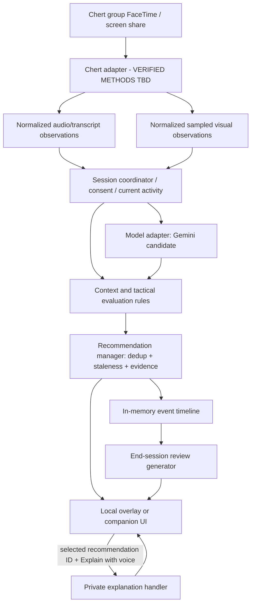

# Sidekick AI — Engineering Specification

**Status:** Architecture and **internal** contracts proposed for MVP; external Chert interfaces **not yet verified**.  
**Primary scope:** One gaming session using real Chert group FaceTime + screen share, proactive quiet text overlay, selected recommendation privately spoken on the requester’s device, event-based debrief.  
**Authority:** Product scope → `requirements.md`; tech commitments → `techstack.md`; build order → `phases.md`; UI → `design.md`.

> **Engineering rule:** Don't build an imaginary Chert SDK. First inspect the sponsor starter and live event payloads. Everything below that references an external integration is a **boundary to implement**, not an assertion that Chert exposes a particular API or endpoint.

## 1. System architecture



### Separation of concerns

- **Chert adapter:** handles external call events/audio/video; normalizes provider details; reports actual capability flags.
- **Session coordinator:** consent, participants, activity, goals, role assignments, lifecycle, latest observations, event history.
- **Model adapter:** extracts structured observations from available frames and conversation; optional explanation/review generation. It never unilaterally declares observed facts true.
- **Situation evaluator:** combines structured current observations, agreed roles/goals and simple tactical rules.
- **Recommendation manager:** prioritizes, deduplicates, timestamps and tracks the lifecycle of advice.
- **Overlay:** presents text cards and buttons; no provider credentials.
- **Voice handler:** selects an existing recommendation, checks staleness, prepares grounded detail and returns explanation text for **private local speech playback** on the requester’s device, never publishing audio to Chert/FaceTime.
- **Review service:** summarizes logged evidence, separates facts/participant reports/inferences, records unknowns.

## 2. Proposed repository layout — scaffold only after starter inspection

```text
sidekick-ai/
  README.md
  CLAUDE.md
  docs/{requirements,techstack,engineering,phases,design}.md
  src/
    adapters/
      chert/              # actual Chert API wrapper, names TBD
      model/              # Gemini or other verified runtime provider
    sessions/             # session state, consent, lifecycle, memory
    observations/         # sampled vision, transcript normalization
    reasoning/            # activity identification, tactical rules
    recommendations/      # create, dedup, stale, explain requests
    reviews/              # log + summary
    api/                  # only endpoints needed by UI/voice flow
  overlay/                # minimal web/desktop UI, exact shape TBD
  tests/                  # pure logic / contract / smoke tests
  .env.example            # verified names only
```

**Implemented so far (session engine, mock inputs only):** `src/contracts/` (shared types + validation), `src/sessions/timeline.ts`, `src/recommendations/recommendation-rules.ts`, `src/engine.ts`, `src/mock/` (clearly labeled mock scenario) and `tests/`. Other folders do not exist yet.

Keep actual Chert starter source layout when it already solves these needs; this tree is a **recommended logical layout**, not a mandate to rewrite starter code.

## 3. Internal data contracts (approved 2026-11-14, revised after review; implemented in `src/contracts/types.ts`)

These interfaces are **ours**, not Chert's event schema. The single source is [`src/contracts/types.ts`](../src/contracts/types.ts); this section summarizes it. If they disagree, fix one of them in the same change. Input validation lives in [`src/contracts/validate.ts`](../src/contracts/validate.ts).

**Status:** implemented and unit-tested with **mock inputs only**. Not yet connected to Chert, Gemini or any UI.

| Contract | Key fields | Notes |
|---|---|---|
| `SessionSnapshot` | `id`, `externalRef?`, `status`, `consentGiven`, `activity`, `activityConfirmed`, `suggestedActivity?`, `contextRevision`, **`captureGeneration`**, `participants[]`, `goals[]`, `decisions[]`, `recommendations[]`, `voiceRequests[]`, `observationCount`, `observationLimitReached`, `timelineTruncated` | Session IDs are engine-generated. `externalRef` is an opaque adapter handle, never parsed. Producers read `captureGeneration` and `contextRevision` from here (§3.2). |
| `Participant` / `RoleChange` | `id`, `displayName`, `externalRef?`, `role?` (string), `lastRoleChange?: { revision, kind: assigned\|cleared, role?, previousRole?, effectiveAt, recordedAt, source, sourceObservationId? }` | `role` is the single source of truth. `lastRoleChange` is kept even after a clear, so the engine can order later changes. |
| `GroupGoal` | `id`, `text`, `statedAt`, `recordedAt`, `source`, `sourceObservationId?`, `revision`, `active`, `retiredAt?`, `retiredRevision?`, `retiredSource?`, `retiredSourceObservationId?` | Explicitly stated goals only. |
| `GroupDecision` | `id`, `text`, `decidedAt`, `recordedAt`, `source`, `sourceObservationIds[]`, `participantIds[]`, `relatedRecommendationId?`, `relatedGoalId?` | Recorded only through `recordDecision` and never inferred. A transcript-sourced decision must cite conversation observations. |
| `ConversationObservation` | `source: 'transcript'`, `text`, `speakerParticipantId?`, `observedAt`, `receivedAt` | The speaker is set only when `speakerRef` matches a participant's verified `externalRef`. |
| `ScreenObservation` | `source: 'screen'`, `summary`, `evidenceQuality`, `facts?`, `frameRef?`, `observedAt`, `receivedAt` | Structured description only. `frameRef` is a short reference (no `data:` URIs) and never reaches the overlay. |
| `ConversationInput` / `ScreenInput` | **`captureGeneration`** (required) + the observation fields minus `id`/`sessionId`/`receivedAt` | **What producers send.** The Chert adapter sends `ConversationInput`; the model adapter sends `ScreenInput`. Observations keep their `captureGeneration`. |
| `ContextOptions` | `source: transcript\|participant_report\|manual`, `sourceObservationId?` | `transcript` **requires** a `sourceObservationId` pointing to a conversation observation. |
| `RecommendationCandidate` | `fingerprint`, `title` (≤80), `shortAdvice` (≤200), **`conditionObservationIds`** (≥1), **`contextObservationIds?`**, `relatedParticipantIds?`, `relatedGoalId?`, `urgency`, **`basedOnContextRevision`** (required) | Condition evidence shows the issue itself (e.g. the empty-zone frames). Context evidence (e.g. the role utterance) never affects freshness. `basedOnContextRevision` is the `contextRevision` the reasoning layer evaluated against. |
| `Recommendation` | candidate fields + `id`, `status`, `staleReason?`, `createdAt`, `updatedAt`, `statusChangedAt`, `lastConditionAt`, `resolvedByObservationId?`, `contextAtCreation` | `lastConditionAt` only moves forward. `contextAtCreation` freezes the related roles and goal as they were when the card was created. |
| `VoiceRequest` | `id`, `recommendationId`, `requesterParticipantId?`, `status: pending\|playing_locally\|finished\|failed\|cancelled`, `cancelReason?`, `requestedAt`, `updatedAt` | One ID per attempt. Every callback must quote it. |
| `ExplanationContext` | `recommendation`, `conditionEvidence[]`, `contextEvidence[]`, `contextAtCreation`, `changesSinceCreation[]`, `isStale`, `staleReason?`, `conditionAgeMs` | Grounding for one card. Later corrections are listed separately, never merged into the original context. |
| `SessionEvent` | `id`, `sessionId`, `time`, `recordedAt`, `summary` + a **typed payload per `type`** | See the event list below. `summary` is a display label only; the review reconstructs everything from the structured fields. |
| `OverlayState` / `RecommendationView` | **`version`** (monotonic), `status`, `activity`, `prominent?`, `history[]` (newest first), `voiceBusy`, `activeVoiceRequest?`; each card has `evidence[]` (`kind: condition\|context`), creation-time `relatedParticipants[]`, `contextChangedSinceCreation`, `staleReason?`, `canExplain`, `voice?` | Plain JSON. Contains no fingerprints, adapter refs, frame refs or transcript text. |
| `Result<T>` | `{ ok: true, value }` or `{ ok: false, error, detail? }` | Public methods never throw on malformed input. A fuzz test covers every method. |

**Event payloads.** `role_updated` carries the full `RoleChange`. `goal_set` and `goal_retired` carry `goalId`, `source`, `sourceObservationId?` and `revision`. `decision_recorded` carries the `GroupDecision`. `observation` carries `observationId`, `source` and `speakerParticipantId?`. `recommendation_created` carries the condition/context IDs, related participants, goal and `contextRevision`. `recommendation_stale` carries a `reason` (`no_recent_condition_evidence`, `session_paused`, `session_ended`, `role_changed` or `goal_changed`) plus `participantId?`/`goalId?`. `voice_requested` and `voice_finished` carry `voiceRequestId`, `outcome` and `cancelReason?`. The remaining payloads are the lifecycle events, `participant_added`, `activity_confirmed`, `recommendation_dismissed` and `recommendation_resolved` (with its `observationId`). `time` is the source time for observations and transcript-derived context, and engine time otherwise; `recordedAt` is always engine time.

**Data invariants:** A recommendation belongs to one session and cites one or more condition observations from that same session. The explanation button sends a **recommendation ID** and receives a **voice request ID**, never an arbitrary instruction. A session review only cites `SessionEvent`/`Observation` objects belonging to that session. Speaker IDs remain optional until real diarization is verified.

### 3.1 Session engine (`SidekickEngine`, `src/engine.ts`)

In-memory `Map` keyed by session ID. It has no I/O, no timers, no persistence and no provider code. The clock and ID generator are injectable for tests. **Out of scope by design:** Chert I/O, Gemini reasoning, game-state interpretation and tactical rules, role/goal/decision extraction from speech, explanation text generation, and private local speech playback.

| Area | Methods |
|---|---|
| Lifecycle | `createSession`, `startWithConsent`, `pause`, `resume`, `end`, `discard` |
| Context | `addParticipant`, `assignRole`, `clearRole`, `setGoal`, `retireGoal`, `recordDecision`, `suggestActivity`, `confirmActivity` |
| Ingest | `ingestConversation`, `ingestScreen`, `getObservation`, `getLatestObservation` |
| Recommendations | `proposeRecommendation`, `dismiss`, `resolve`, `sweepStale`, `sweepAll` |
| Voice | `getExplanationContext` (read-only), `requestExplanation`, `reportVoiceStatus`, `cancelExplanation` |
| Reads / UI | `getSession`, `getOverlayState`, `getTimeline`, `subscribe` |

**Capture generations.** Timestamps can't reliably say whether something was captured before or after a pause, because producer clocks may be skewed. Instead, the engine keeps `captureGeneration`, an integer that starts at 0 and increments on every start, pause, resume and end (start = 1, pause = 2, resume = 3, …). Generations during which the session was active are recorded. The producer stamps each input with the generation it read **when the raw input was captured**, and every input must carry one. Ingest rejects with `invalid_generation` any input:
- stamped with a paused or ended generation, i.e. captured while not observing;
- stamped with an unknown or future generation;
- whose generation is malformed.

Inputs from an **earlier active** generation are stored and placed in the timeline, so they can serve as context evidence or role/goal provenance. They can **never** be condition evidence: `stale_evidence` "captured before the last pause/resume". This replaces the earlier rule that relied only on timestamps around a pause. A post-resume capture whose clock lags into the pause window is therefore valid, and a pre-pause capture whose clock runs ahead is not.

**Timestamp rules.** `observedAt` must be ISO 8601 with a timezone. Calendar overflow such as Feb 30 is rejected; the engine normalizes accepted values to UTC. The engine rejects an observation (`timestamp_out_of_range`) when it is:
- more than `maxClockSkewMs` in the future;
- earlier than consent minus the skew.

Late observations inside those bounds are stored and placed in the timeline at their source time. They don't replace the latest observation of their source unless they are newer by source time. As condition evidence, a late observation can extend a card's freshness only if its `observedAt` is newer than the card's `lastConditionAt`.

**Role ordering and precedence.** Each role change has an `effectiveAt`: the utterance's `observedAt` for `transcript` changes, and engine time for `manual` or `participant_report` changes. A clear counts as a change. The rules:
- A **verified correction** (`manual` or `participant_report`) always applies over whatever is currently applied. Corrections are live user actions, ordered by arrival. Any applied transcript change was admitted with `observedAt ≤ arrival + maxClockSkewMs`, so it can't be later than the click.
- A **transcript-derived change** applies over a verified correction only if `effectiveAt > correction + maxClockSkewMs`, meaning it was certainly spoken afterwards even at the maximum allowed skew. With `maxClockSkewMs: 0`, the statement has to be strictly after the correction.
- **Transcript vs transcript:** the newer or equal utterance time wins.

Restating the current role refreshes the ordering without creating an event. Ignored changes return `outcome: 'ignored_superseded'` and do not bump `contextRevision`.

**Context revision (reasoning contract).** `contextRevision` increments on every applied role assignment, role clear, goal set and goal retirement. Restatements and ignored changes don't increment it. The reasoning layer reads it before evaluating a rule and returns it as `basedOnContextRevision`. If any role or goal changed in between, the candidate is rejected with `stale_context` and must be re-evaluated. A changed role belonging to an unrelated participant also counts, because "who covers left" can change through anyone. So a delayed result can never recreate or refresh advice that a newer correction invalidated. A revision newer than the session's is `invalid_input`. Accepted cards record the revision in `contextAtCreation.contextRevision`.

**Recommendation rules** (`src/recommendations/recommendation-rules.ts` + `proposeRecommendation`):

1. Only `conditionObservationIds` affect freshness. A screen observation with `evidenceQuality: 'unknown'` can't be condition evidence (`insufficient_evidence`).
2. A candidate is rejected:
   - with `stale_context` if `basedOnContextRevision` is behind the session;
   - with `stale_evidence` if any condition observation is from an earlier capture generation;
   - with `stale_evidence` if its newest condition evidence is older than `staleAfterMs`.

   After a pause, only condition evidence captured after the resume can create a card.
3. If a card with the same `fingerprint` is **active**, the candidate is **merged**. Evidence is appended, `lastConditionAt` advances only on newer condition evidence, and the card's text and creation context stay unchanged. No new card and no event.
4. If the most recent same-fingerprint card was **dismissed or resolved** less than `cooldownMs` ago, the candidate is **suppressed**.
5. A **stale** card doesn't block a new card for the same issue, as long as the new card's own evidence passes rule 2.
6. A card becomes stale when:
   - `now − lastConditionAt > staleAfterMs` (checked on every ingest, propose, `sweepStale` and `sweepAll`);
   - the session pauses or ends;
   - a related participant's role changes (`role_changed`) or the related goal is retired (`goal_changed`).
7. `resolve` requires an observation whose source time is strictly newer than `lastConditionAt`.

**Voice requests.** `requestExplanation` creates a request with a unique ID; only one request per session can be live at a time (`voice_busy`). `reportVoiceStatus` accepts `playing_locally`, then `finished` or `failed`, and only for the current live request. Unknown IDs return `voice_request_not_found`; superseded or terminal IDs return `invalid_transition`. Playback can't start unless the session is active. Cancellation rules:
- **Pause:** `cancelled` with reason `session_paused`.
- **End:** `cancelled` with reason `session_ended`.
- **Stop button or disconnected client:** `cancelExplanation` with reason `user` or `client_disconnected`.
- **No callback within `voiceRequestTimeoutMs`:** `cancelled` with reason `timeout`.
- **Discard:** the request is abandoned with the session; later callbacks return `session_not_found`, and the discarding UI must stop its own playback.

The UI must stop speaking whenever `OverlayState.activeVoiceRequest` disappears or changes. Speech synthesis is **not** in the engine; playback is local to the requester's device and never enters the shared call.

**Overlay notification semantics.** Listener callbacks never run inside an engine operation. Each change bumps the session's `version`, and when the outermost public call returns, the engine delivers the **current** `OverlayState` to each listener that is behind, in subscription order. Calls a listener makes during delivery (reentrant calls) run as normal, complete operations. They don't deliver anything themselves. If one of them changes the state, the current delivery round stops and restarts with the newer state. The guarantees:
- every listener receives strictly increasing `version`s and ends on the latest state;
- a listener never receives a snapshot from before a pause, end or cancellation that has already happened;
- after `discard`, nothing more is delivered.

A listener that keeps changing state on every callback is stopped after 50 rounds per flush and reported through `onListenerError`. If a transport can reorder messages, the UI should ignore any snapshot whose `version` is not greater than the last one it applied.

**Configuration** (`EngineConfig`, all overridable in the constructor): `cooldownMs` 30 000, `staleAfterMs` 15 000, `maxClockSkewMs` 5 000, `maxObservations` 2 000, `maxTimelineEvents` 5 000, `voiceRequestTimeoutMs` 60 000. These are **test/demo defaults**, not tuned values.

**Bounds.** Observations are capped per session; past the cap, new ones are rejected with `observation_limit_reached` and `observationLimitReached` is set. Timeline events are capped too; past the cap, new events are dropped (except `session_ended`) and `timelineTruncated` is set so the review can state the gap. Participants, goals, decisions and voice requests are not separately capped; they grow only through explicit calls.

**Privacy.** Everything is held in memory. The engine accepts no raw audio, video or frames; screen input is a text summary plus primitive facts. Transcript text stays on its observation, and timeline summaries say only who spoke. `discard()` clears observations, recommendations, participants, role history, goals, decisions, voice requests, the timeline and every overlay subscription, then deletes the session.

### 3.2 Integration seams

- **Chert adapter → engine:** call `createSession({ externalRef })` once per call and keep the returned session ID. Call `startWithConsent` only after explicit opt-in. For each transcript event, map it to `ConversationInput` and call `ingestConversation`. Set `speakerRef` (and the participants' `externalRef`) only if CH-3 proves speaker attribution. Frames go to the **model adapter**, which calls `ingestScreen` with a `ScreenInput`. **Capture generation:** when a Chert transcript event or frame arrives, the adapter reads `getSession(id).captureGeneration` (or keeps the value returned by `startWithConsent`/`resume`) and attaches it to that raw input, before any queueing or model call. The same number must travel with the frame into the model adapter and on to `ingestScreen`; it must never be re-read at ingest time. This needs no Chert field, and nothing is assumed about Chert timestamps. If the adapter can't tell when a buffered input was captured, it should drop that input after a pause rather than guess. Call `sweepAll()` every 1–2 s. If the requesting client disconnects, call `cancelExplanation(…, 'client_disconnected')`. The engine never sees Chert types.
- **Reasoning layer → engine:** reads `getSession` / `getLatestObservation`. Calls `assignRole`/`clearRole`, `setGoal`/`retireGoal`, `recordDecision` and `confirmActivity` with `source: 'transcript'` and the source utterance ID. Calls `proposeRecommendation`, separating condition evidence from context, and `resolve` when a newer frame shows the issue fixed. Re-proposes after a `role_changed` or `goal_changed` invalidation if the advice still applies. **Every candidate carries `basedOnContextRevision`:** the reasoning module (Gemini adapter) reads `getSession(id).contextRevision` together with the roles and goals it puts in the prompt, and sends that number back with the result. On `stale_context`, it re-reads the context and re-evaluates; it must not retry the same candidate.
- **Engine → overlay:** `subscribe(sessionId, listener)` emits a full `OverlayState` when the subscribe call returns, and after each operation that changes state. Snapshots carry a monotonic `version`. The transport is the integrator's choice. The UI sends back `dismiss` and manual role corrections (`source: 'manual'`). For Explain, it calls `requestExplanation` → backend generates text from `context` → the requester's device plays it locally → `reportVoiceStatus(requestId, …)`, or `cancelExplanation` on Stop.
- **Engine → review:** `getTimeline` returns ordered, typed events. `getObservation` resolves evidence, and `getSession` provides goals, decisions and role history.

## 4. Session lifecycle and privacy

| State | Input processing | Text/voice behavior | Review behavior |
|---|---|---|---|
| `starting` | No continuous capture until consent | Show setup/permissions | None |
| `active` | Process approved audio+screen input; sampled vision | Proactive quiet **text**, voice only on selected button | Record minimal events |
| `paused` | Stop **new** observation processing | Mark existing cards stale if needed; do not generate new advice | Retain prior event log in memory |
| `ended` | Stop input and do not rejoin automatically | No further live advice | Offer Generate Review / Discard |

All participants should be informed of live AI processing and be able to see active state. Consent must be explicit, not inferred because someone joined the call. Never run persistent background capture; stop new inference on Stop/Pause. Raw audio and video are not retained by default. Review event history is in memory and can be discarded; do not upload it to public telemetry.

## 5. Conversation and visual observation loop

1. Chert receives a call event. Convert actual supported payloads into our normalized `Observation` objects.
2. Track stated roles and goals using explicit wording and corrections; don't guess who spoke if no speaker ID exists.
3. On approved screen share, sample a frame as budget/latency permits. **3–5 seconds is an experimental starting point, not guaranteed performance.**
4. Ask the model for a **structured description** of only what the frame shows, with evidence-quality indication. Do not infer unseen score, player identity or invisible game state.
5. Apply narrow tactical logic for the chosen demo: *assigned left defender absent from clearly defined left defensive zone and no visible coverage → left zone may be exposed*. If detection confidence is insufficient, withhold or hedge the suggestion.
6. Compare to prior state; generate one relevant text card, deduplicate repeated observations, and log the evidence.
7. Continue quietly. **No automatic speech** for recommendations.

A deterministic soccer-field simulation with visible labeled/colored markers can make the visual condition testable; commercial game understanding is a stretch.

## 6. Recommendation lifecycle

```text
new grounded issue → candidate → dedup / relevance check → ACTIVE CARD
                                            |
                        new observation? → update / mark resolved / stale
                        user dismisses → dismissed
                        user taps Explain with voice → voice flow
```

The concrete, implemented rules are listed in §3.1. MVP safeguards:

- Only one prominent recommendation displayed at a time; history can retain earlier cards.
- Key the underlying issue with a stable fingerprint (e.g., `left_defense_uncovered` + session/game context), so multiple frames of the same issue do not spam cards.
- Use a brief cooldown after an equivalent recommendation; exact duration is a tuning value.
- Do not mark issue resolved without a newer observation supporting it.
- A card is **stale** if there is no recent supporting observation; don't read old advice as a current fact.
- Model outputs are untrusted suggestions: validate structure, size, evidence links and phrasing before UI display.

## 7. Selected recommendation → private speech flow

1. User clicks the **Explain with voice** control attached to `recommendationId`.
2. Backend verifies active session and the card's ownership/status; fetches stored short advice, referenced observations, group goals and roles.
3. If evidence is outdated, preface explanation with “Earlier…” or say it's no longer confirmed.
4. Generate concise expanded guidance: **what was observed → why it matters → suggested corrective actions → any uncertainty**.
5. Return the grounded explanation to the requesting user’s companion UI. Trigger **local speech synthesis**, ideally from the user’s click, without publishing any audio track to Chert, LiveKit, or FaceTime.
6. Track each attempt as a voice request with a unique ID: `pending` → `playing_locally` → `finished`, `failed` or `cancelled` (see §3.1). Return to quiet text automatically. No overlapping explanations, and stale callbacks are rejected.
7. If private playback fails, display the detailed text explanation **clearly labeled as a fallback**. Test cancel/stop and check microphone loopback; recommend headphones.

**Example expected words, if evidence supports them:** “Earlier, your assigned left defender advanced and the left defensive area looked open. If possession changes, that space could be exploited. Have Alex recover or ask another teammate to cover the left.”

## 8. End-of-session event review

At `ended`, the UI offers **Generate Review** or **Discard**. The review generator accepts the bounded event timeline (`maxTimelineEvents`; truncation is flagged) and related structured observations; it does not need or automatically retain a raw recording.

Proposed review contract:

```ts
interface SessionReview {
  sessionId: string;
  generatedAt: string;
  activity: string;
  overview: string;
  keyMoments: Array<{ eventIds: string[]; time?: string; whatHappened: string }>;
  strengths: string[];                 // omit if no supporting evidence
  improvementAreas: string[];          // cite observed events in UI when possible
  nextActions: string[];
  limitations: string[];               // gaps, uncertain identities, sparse sampling
}
```

The review is about **observed moments**, not complete match telemetry. `voice_requested` indicates interest in the advice, not proof the player followed it. Generate “not enough evidence” when appropriate. Keep event count bounded and allow explicit discard.

## 9. Internal interfaces (examples, not implemented endpoints)

Prefer the Chert starter's transport. If a companion overlay needs an API, it might need these **internal operations**, regardless of REST/WebSocket shape:

| Operation | Inputs | Returns / effect |
|---|---|---|
| `getSessionState` | authenticated/paird session reference | consent/status/activity/current cards |
| `getRecommendations` | session reference | latest short cards with stable IDs |
| `requestVoiceExplanation` | authorized requester, session reference, `recommendationId` | grounded explanation text and playback status for local TTS; no shared audio |
| `endSession` | session reference | observation processing stopped; review offered |
| `generateReview` | ended session reference | event-grounded summary |
| `discardSession` | session reference | clear in-memory event/context data |

Do not expose these publicly without session scoping, restricted origin, appropriate short-lived access/pairing, input validation and limits. **Do not interpret these operation names as existing Chert endpoints.**

## 10. Integration verification gates — REQUIRED before locking adapter design

| Test | Procedure | Pass evidence / fallback |
|---|---|---|
| **CH-1 Group FaceTime** | Agent joins a real group call | Actual call + stable session ID; else stop and fix setup |
| **CH-2 Incoming screen share** | Participant shares recognizable game/simulation screen | Agent process receives verifiable frame from screen stream; if unavailable, document actual API and reconsider capture path |
| **CH-3 Conversation processing** | State role then query session context | Observed transcript/raw input available; if no speaker attribution, require explicit names |
| **CH-4 Private voice** | Click a selected card on a participant’s device | Explanation plays only on that device. Verify no audio track goes to Chert and, using headphones, that other FaceTime participants do not hear it |
| **CH-5 Overlay feasibility** | Display suggestion over game on target desktop | If true overlay fails, companion panel is clearly labeled a fallback and overlay P0 remains incomplete |
| **CH-6 Session end** | Stop then request review | No new frames/audio processed; report uses logged events |

Keep short notes on **tested date, setup, actual SDK interface, successful result, latency, errors, limitations, and owner**. Never check in raw private event payloads if they contain sensitive identifiers or content; redact examples.

### Explicit current unknowns

- Chert method/event for **incoming FaceTime screen-share frames** (team says capability exists, API unknown).
- Incoming **audio vs transcripts**, participant attribution and timing.
- Supported **private local speech synthesis** and cancellation; user-gesture requirements; avoid call audio injection and test acoustic feedback.
- Supported **overlay rendering**: OS-native over-game, companion browser panel, or FaceTime outgoing video are not interchangeable.
- Callback/network/hosting requirements; sampling throughput, latency/cost; simultaneous video/speech routing.

## 11. Testing requirements

Session-engine unit tests live in `tests/` and run with `npm test` (they cover lifecycle, consent, roles, observations, recommendations, timeline, overlay snapshots, voice grounding and a mock smoke scenario). Contract tests for model output and the voice endpoint, and all live tests below, are still open.


- Unit: new role updates supersede old role; session isolation; activity confirmation; fingerprint dedup; cooldown; stale/resolved rules; no unsourced confidence or invented metrics; stopped session ignores observations.
- Contract: malformed model output rejected; invalid recommendation ID cannot trigger speech; cross-session IDs cannot read other sessions; repeated explain button cannot cause overlapping speech.
- Review: references valid event IDs; explicitly unknown outcomes remain unknown; no events → honest empty review.
- Manual end-to-end: real call + screen visual change + quiet card + selected **private local speech** + debrief, rehearsed twice on target network.
- Failure: Chert disconnect; no screen; delayed frame; unavailable transcript; model timeout; voice failure; overlay hidden; participant stops monitoring.

## 12. Priority and change procedure

The **product** is locked in `requirements.md`. Internal schemas here are the **proposed default** and may be revised when the working Chert starter proves a different data model is necessary. Change this document **before** simultaneously updating multiple modules, note the reason, update tests and any `phases.md` dependency. Keep integration adapters thin; never pretend the software already exists because this spec names a module.

## Decision update — private explanation (confirmed 2026-11-14)

- **Who hears it:** Only the participant who clicked **Explain with voice** on a selected recommendation.
- **Where it plays:** Locally on that participant’s companion device, preferably through headphones. No TTS audio may be published into the FaceTime/LiveKit room or shared Chert call. If speakers are used, acoustic microphone pickup can still leak audio; test and warn.
- **How it works:** The backend returns grounded explanation **text** tied to the selected recommendation ID and event evidence; the local UI handles TTS playback, stop/cancel, and an on-screen text fallback. Browser `speechSynthesis` is a candidate, not a finalized tested dependency.
- **Unchanged:** Continuous group-aware input during an explicitly consented active session; proactive quiet overlay advice; gaming-first hackathon MVP; mandatory event-based end-of-session review.
- **Dami/PITWALL reconciliation:** Adopt the private companion audio concept and modular Chert + Gemini + session-coordinator architecture, but **do not** expand MVP scope to iMessage, an always-on general assistant, a browser extension, or five separate modes.

## Gemini reasoning boundary (feature/gemini-reasoning)

The independently runnable reasoning module uses normalized ENGINE-INGESTED observations with IDs,
session IDs, capture generations and source timestamps. It accepts a read-only session snapshot,
engine clock and explicit staleAfterMs. It returns proposed context updates and recommendation
candidates with separate condition/context evidence, preserving contextRevision. No state mutation,
deduplication, lifecycle, Chert or frontend behavior is owned by reasoning. Exact quotes and local
freshness/scope checks supplement model prompting, but do not prove semantic entailment.

The published session-engine contract at 1bc0e9f1414fdb18dbcb95f4f41b79d80a0e9a88 is the integration
reference. Structural type compatibility and real-engine acceptance are checked in a temporary copy;
shared contracts are not overwritten. Apply context updates through engine APIs, re-read state,
and re-evaluate if revision changes. Cancel on Pause/End and let the engine reject stale late results.
See docs/reasoning.md for complete handoff, limitations and commands. Raw-frame ingestion and live
Chert remain unverified; the Gemini adapter reasons over supplied summaries, not fetched frameRef media.

## Imported LiveKit Agent Builder export (2026-11-14)

The Agent Builder export is integrated under `agent/`; the source and its entrypoint are preserved. Inspection of `agent/src/agent.py` shows a LiveKit `AgentServer` with an `rtc_session` entrypoint, an `AgentSession`, a `DuplexModel` configured as `openai/gpt-live-1`, and the exported ai-coustics audio enhancement hook. The package configuration declares `livekit-agents`, the ai-coustics and noise-cancellation plugins, `python-dotenv`, and `python-handlebars`; the dev group contains pytest, pytest-asyncio, and Ruff. The documented local entrypoint is `uv run python src/agent.py dev`; Docker starts `src/agent.py start`.

The shared runtime is pinned to Python 3.13 in `agent/.python-version`, `pyproject.toml`, CI, and Docker. The export did **not** include `uv.lock`; dependencies are still version ranges and are not yet exactly reproducible across installs. Generate and commit a lockfile when package-index access is available.

**Integration status:** these findings are from the exported source and docs only. No real LiveKit or Chert session was run. The source does not contain a Chert adapter or Sidekick recommendation/overlay/review path. Chert screen-share frame shapes, transcript events, consent/lifecycle behavior, overlay delivery, and the product's selected voice action remain unverified. Do not present the exported LiveKit starter as a tested Chert integration.

### Gemini live smoke follow-up

The normalized synthetic reasoning path was exercised against gemini-3.5-flash-lite. A provider-schema
compatibility fix omits maxItems/additionalProperties from the API schema; strict local output validation
still enforces both. A full live request returned one evidence-linked candidate successfully. Exact
quote coverage for condition and context evidence is explicitly prompted and locally verified. This
is a one-fixture Gemini transport/validation proof only; Chert, raw vision and overall accuracy remain
unverified. See docs/reasoning-verification.md for the distinction from earlier mock-only results.
