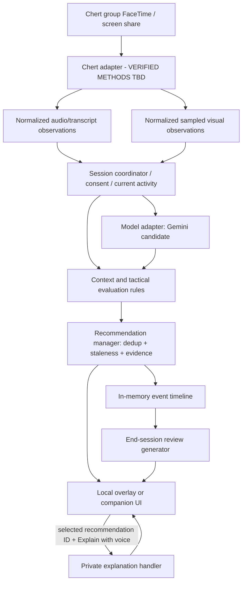

# Sidekick AI — Engineering Specification

**Status:** Architecture and **internal** contracts proposed for MVP; external Chert interfaces **not yet verified**.  
**Primary scope:** One gaming session using real Chert group FaceTime + screen share, proactive quiet text overlay, selected recommendation privately spoken on the requester’s device, event-based debrief.  
**Authority:** Product scope → `requirements.md`; tech commitments → `techstack.md`; build order → `phases.md`; UI → `design.md`.

> **Engineering rule:** Don't build an imaginary Chert SDK. First inspect the sponsor starter and live event payloads. Everything below that references an external integration is a **boundary to implement**, not an assertion that Chert exposes a particular API or endpoint.

## 1. System architecture



### Separation of concerns

- **Chert adapter:** handles external call events/audio/video; normalizes provider details; reports actual capability flags.
- **Session coordinator:** consent, participants, activity, goals, role assignments, lifecycle, latest observations, event history.
- **Model adapter:** extracts structured observations from available frames and conversation; optional explanation/review generation. It never unilaterally declares observed facts true.
- **Situation evaluator:** combines structured current observations, agreed roles/goals and simple tactical rules.
- **Recommendation manager:** prioritizes, deduplicates, timestamps and tracks the lifecycle of advice.
- **Overlay:** presents text cards and buttons; no provider credentials.
- **Voice handler:** selects an existing recommendation, checks staleness, prepares grounded detail and returns explanation text for **private local speech playback** on the requester’s device, never publishing audio to Chert/FaceTime.
- **Review service:** summarizes logged evidence, separates facts/participant reports/inferences, records unknowns.

## 2. Proposed repository layout — scaffold only after starter inspection

```text
sidekick-ai/
  README.md
  CLAUDE.md
  docs/{requirements,techstack,engineering,phases,design}.md
  src/
    adapters/
      chert/              # actual Chert API wrapper, names TBD
      model/              # Gemini or other verified runtime provider
    sessions/             # session state, consent, lifecycle, memory
    observations/         # sampled vision, transcript normalization
    reasoning/            # activity identification, tactical rules
    recommendations/      # create, dedup, stale, explain requests
    reviews/              # log + summary
    api/                  # only endpoints needed by UI/voice flow
  overlay/                # minimal web/desktop UI, exact shape TBD
  tests/                  # pure logic / contract / smoke tests
  .env.example            # verified names only
```

Keep actual Chert starter source layout when it already solves these needs; this tree is a **recommended logical layout**, not a mandate to rewrite starter code.

## 3. Internal data contracts (proposed; TypeScript illustrations)

These interfaces are **ours**, not Chert's event schema. Define them centrally and validate data at input boundaries. Use ISO timestamps and stable session IDs; all times must preserve ordering even if provider events arrive late.

```ts
export type SessionStatus = 'starting' | 'active' | 'paused' | 'ended';
export type Activity = 'unconfirmed' | 'gaming' | 'planning' | 'social';
export type RecommendationStatus = 'active' | 'dismissed' | 'resolved' | 'stale';

export interface Session {
  id: string;                          // server-generated; never trust arbitrary client IDs
  status: SessionStatus;
  consentActive: boolean;               // true only after session permission granted
  activity: Activity;
  activityConfirmed: boolean;
  startedAt: string;
  endedAt?: string;
  participants: Record<string, { displayName?: string; role?: string }>;
  goals: string[];                     // explicit session goals only
  latestObservationIds: string[];
  recommendationIds: string[];
}

export interface Observation {
  id: string;
  sessionId: string;
  observedAt: string;
  source: 'transcript' | 'screen' | 'participant_report';
  summary: string;                     // short, no raw frames/audio
  speakerId?: string;                  // absent when not verified
  evidenceQuality: 'clear' | 'partial' | 'unknown';
  frameRef?: string;                   // ephemeral ref only; do not persist raw media
}

export interface Recommendation {
  id: string;
  sessionId: string;
  createdAt: string;
  status: RecommendationStatus;
  title: string;
  shortAdvice: string;
  evidenceObservationIds: string[];
  relatedGoal?: string;
  urgency: 'normal' | 'important';
  voiceRequestedAt?: string;
  voiceDeliveryStatus?: 'pending' | 'playing_locally' | 'finished' | 'failed';
}

export interface SessionEvent {
  id: string;
  sessionId: string;
  time: string;
  type: 'role_updated' | 'activity_confirmed' | 'observation' |
    'recommendation_created' | 'recommendation_dismissed' |
    'recommendation_resolved' | 'voice_requested' | 'voice_finished' |
    'session_started' | 'session_ended';
  observationIds?: string[];
  recommendationId?: string;
  summary: string;
}
```

**Data invariants:** A recommendation belongs to one session and cites one or more supporting observations or an explicitly labeled participant statement. The explanation button sends a **recommendation ID**, not an arbitrary ungrounded instruction. A session review only cites `SessionEvent`/`Observation` objects belonging to that session. Speaker IDs remain optional until real diarization is verified.

## 4. Session lifecycle and privacy

| State | Input processing | Text/voice behavior | Review behavior |
|---|---|---|---|
| `starting` | No continuous capture until consent | Show setup/permissions | None |
| `active` | Process approved audio+screen input; sampled vision | Proactive quiet **text**, voice only on selected button | Record minimal events |
| `paused` | Stop **new** observation processing | Mark existing cards stale if needed; do not generate new advice | Retain prior event log in memory |
| `ended` | Stop input and do not rejoin automatically | No further live advice | Offer Generate Review / Discard |

All participants should be informed of live AI processing and be able to see active state. Consent must be explicit, not inferred because someone joined the call. Never run persistent background capture; stop new inference on Stop/Pause. Raw audio and video are not retained by default. Review event history is in memory and can be discarded; do not upload it to public telemetry.

## 5. Conversation and visual observation loop

1. Chert receives a call event. Convert actual supported payloads into our normalized `Observation` objects.
2. Track stated roles and goals using explicit wording and corrections; don't guess who spoke if no speaker ID exists.
3. On approved screen share, sample a frame as budget/latency permits. **3–5 seconds is an experimental starting point, not guaranteed performance.**
4. Ask the model for a **structured description** of only what the frame shows, with evidence-quality indication. Do not infer unseen score, player identity or invisible game state.
5. Apply narrow tactical logic for the chosen demo: *assigned left defender absent from clearly defined left defensive zone and no visible coverage → left zone may be exposed*. If detection confidence is insufficient, withhold or hedge the suggestion.
6. Compare to prior state; generate one relevant text card, deduplicate repeated observations, and log the evidence.
7. Continue quietly. **No automatic speech** for recommendations.

A deterministic soccer-field simulation with visible labeled/colored markers can make the visual condition testable; commercial game understanding is a stretch.

## 6. Recommendation lifecycle

```text
new grounded issue → candidate → dedup / relevance check → ACTIVE CARD
                                            |
                        new observation? → update / mark resolved / stale
                        user dismisses → dismissed
                        user taps Explain with voice → voice flow
```

MVP safeguards:

- Only one prominent recommendation displayed at a time; history can retain earlier cards.
- Key the underlying issue with a stable fingerprint (e.g., `left_defense_uncovered` + session/game context), so multiple frames of the same issue do not spam cards.
- Use a brief cooldown after an equivalent recommendation; exact duration is a tuning value.
- Do not mark issue resolved without a newer observation supporting it.
- A card is **stale** if there is no recent supporting observation; don't read old advice as a current fact.
- Model outputs are untrusted suggestions: validate structure, size, evidence links and phrasing before UI display.

## 7. Selected recommendation → private speech flow

1. User clicks the **Explain with voice** control attached to `recommendationId`.
2. Backend verifies active session and the card's ownership/status; fetches stored short advice, referenced observations, group goals and roles.
3. If evidence is outdated, preface explanation with “Earlier…” or say it's no longer confirmed.
4. Generate concise expanded guidance: **what was observed → why it matters → suggested corrective actions → any uncertainty**.
5. Return the grounded explanation to the requesting user’s companion UI. Trigger **local speech synthesis**, ideally from the user’s click, without publishing any audio track to Chert, LiveKit, or FaceTime.
6. Mark delivery as `pending` → `playing` (if supported) → `finished` or `failed`; return to quiet text automatically. No overlapping explanations.
7. If private playback fails, display the detailed text explanation **clearly labeled as a fallback**. Test cancel/stop and check microphone loopback; recommend headphones.

**Example expected words, if evidence supports them:** “Earlier, your assigned left defender advanced and the left defensive area looked open. If possession changes, that space could be exploited. Have Alex recover or ask another teammate to cover the left.”

## 8. End-of-session event review

At `ended`, the UI offers **Generate Review** or **Discard**. The review generator accepts the bounded event timeline and related structured observations; it does not need or automatically retain a raw recording.

Proposed review contract:

```ts
interface SessionReview {
  sessionId: string;
  generatedAt: string;
  activity: string;
  overview: string;
  keyMoments: Array<{ eventIds: string[]; time?: string; whatHappened: string }>;
  strengths: string[];                 // omit if no supporting evidence
  improvementAreas: string[];          // cite observed events in UI when possible
  nextActions: string[];
  limitations: string[];               // gaps, uncertain identities, sparse sampling
}
```

The review is about **observed moments**, not complete match telemetry. `voice_requested` indicates interest in the advice, not proof the player followed it. Generate “not enough evidence” when appropriate. Keep event count bounded and allow explicit discard.

## 9. Internal interfaces (examples, not implemented endpoints)

Prefer the Chert starter's transport. If a companion overlay needs an API, it might need these **internal operations**, regardless of REST/WebSocket shape:

| Operation | Inputs | Returns / effect |
|---|---|---|
| `getSessionState` | authenticated/paird session reference | consent/status/activity/current cards |
| `getRecommendations` | session reference | latest short cards with stable IDs |
| `requestVoiceExplanation` | authorized requester, session reference, `recommendationId` | grounded explanation text and playback status for local TTS; no shared audio |
| `endSession` | session reference | observation processing stopped; review offered |
| `generateReview` | ended session reference | event-grounded summary |
| `discardSession` | session reference | clear in-memory event/context data |

Do not expose these publicly without session scoping, restricted origin, appropriate short-lived access/pairing, input validation and limits. **Do not interpret these operation names as existing Chert endpoints.**

## 10. Integration verification gates — REQUIRED before locking adapter design

| Test | Procedure | Pass evidence / fallback |
|---|---|---|
| **CH-1 Group FaceTime** | Agent joins a real group call | Actual call + stable session ID; else stop and fix setup |
| **CH-2 Incoming screen share** | Participant shares recognizable game/simulation screen | Agent process receives verifiable frame from screen stream; if unavailable, document actual API and reconsider capture path |
| **CH-3 Conversation processing** | State role then query session context | Observed transcript/raw input available; if no speaker attribution, require explicit names |
| **CH-4 Private voice** | Click a selected card on a participant’s device | Explanation plays only on that device. Verify no audio track goes to Chert and, using headphones, that other FaceTime participants do not hear it |
| **CH-5 Overlay feasibility** | Display suggestion over game on target desktop | If true overlay fails, companion panel is clearly labeled a fallback and overlay P0 remains incomplete |
| **CH-6 Session end** | Stop then request review | No new frames/audio processed; report uses logged events |

Keep short notes on **tested date, setup, actual SDK interface, successful result, latency, errors, limitations, and owner**. Never check in raw private event payloads if they contain sensitive identifiers or content; redact examples.

### Explicit current unknowns

- Chert method/event for **incoming FaceTime screen-share frames** (team says capability exists, API unknown).
- Incoming **audio vs transcripts**, participant attribution and timing.
- Supported **private local speech synthesis** and cancellation; user-gesture requirements; avoid call audio injection and test acoustic feedback.
- Supported **overlay rendering**: OS-native over-game, companion browser panel, or FaceTime outgoing video are not interchangeable.
- Callback/network/hosting requirements; sampling throughput, latency/cost; simultaneous video/speech routing.

## 11. Testing requirements

- Unit: new role updates supersede old role; session isolation; activity confirmation; fingerprint dedup; cooldown; stale/resolved rules; no unsourced confidence or invented metrics; stopped session ignores observations.
- Contract: malformed model output rejected; invalid recommendation ID cannot trigger speech; cross-session IDs cannot read other sessions; repeated explain button cannot cause overlapping speech.
- Review: references valid event IDs; explicitly unknown outcomes remain unknown; no events → honest empty review.
- Manual end-to-end: real call + screen visual change + quiet card + selected **private local speech** + debrief, rehearsed twice on target network.
- Failure: Chert disconnect; no screen; delayed frame; unavailable transcript; model timeout; voice failure; overlay hidden; participant stops monitoring.

## 12. Priority and change procedure

The **product** is locked in `requirements.md`. Internal schemas here are the **proposed default** and may be revised when the working Chert starter proves a different data model is necessary. Change this document **before** simultaneously updating multiple modules, note the reason, update tests and any `phases.md` dependency. Keep integration adapters thin; never pretend the software already exists because this spec names a module.

## Decision update — private explanation (confirmed 2026-11-14)

- **Who hears it:** Only the participant who clicked **Explain with voice** on a selected recommendation.
- **Where it plays:** Locally on that participant’s companion device, preferably through headphones. No TTS audio may be published into the FaceTime/LiveKit room or shared Chert call. If speakers are used, acoustic microphone pickup can still leak audio; test and warn.
- **How it works:** The backend returns grounded explanation **text** tied to the selected recommendation ID and event evidence; the local UI handles TTS playback, stop/cancel, and an on-screen text fallback. Browser `speechSynthesis` is a candidate, not a finalized tested dependency.
- **Unchanged:** Continuous group-aware input during an explicitly consented active session; proactive quiet overlay advice; gaming-first hackathon MVP; mandatory event-based end-of-session review.
- **Dami/PITWALL reconciliation:** Adopt the private companion audio concept and modular Chert + Gemini + session-coordinator architecture, but **do not** expand MVP scope to iMessage, an always-on general assistant, a browser extension, or five separate modes.
